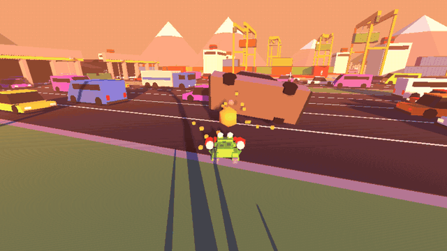
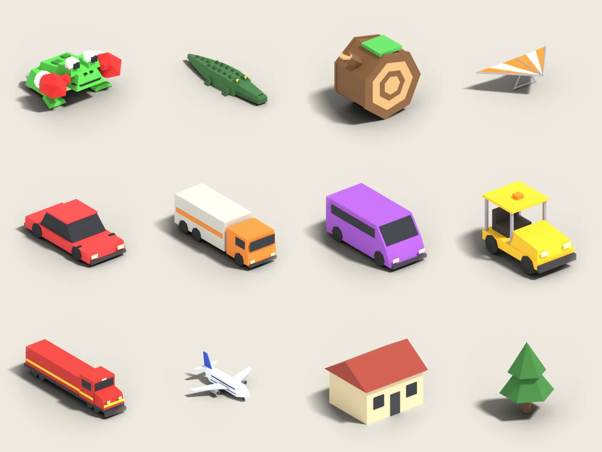

# Frogger 3D

*A frog with superpowers and a world that reacts to chaos.*



A 3D, third-person homage to Frogger, in low-poly PS1 style. The frog has to cross roads, rivers, railways, airports and harbours while a wildfire chases it from behind. It can punch cars: a punched car flies off and crashes into the others, and the wrecks turn into obstacles, rafts and more projectiles. The more chaos you cause, the more dangerous the world gets.

It's a roguelite with endless runs: in the dens you pick cards to build your frog, and between runs you unlock new frogs, cards and hats.

## Play

Download the zip for your system from the [Releases](../../releases), extract it and run `Frogger3D.x86_64` (Linux) or `Frogger3D.exe` (Windows). Nothing to install. The game is in English and Italian (choose in the options).

| Action | Keyboard and mouse | Controller |
| --- | --- | --- |
| Move | WASD | Left stick |
| Look around | Mouse | Right stick |
| Jump (hold in the air: glider) | Space | A |
| Punch | Left click | RT |
| Super jump | Right click | RB |
| Tongue | E | LT |
| Ground slam | Ctrl | B |
| Pause | Esc | Start |
| Graphics style (PS1, Base, Arcade…) | F2 | |

Controls can be rebound in the options. F1 opens the test mode (heat level, biomes, cards on demand): it's the tool used during development, and it stayed in.

## From source

You need [Godot 4.7](https://godotengine.org/). Open the project folder in Godot, or from a terminal:

```
godot --path .
```

| What | Command |
| --- | --- |
| Automated tests | `tests/run.sh` |
| Start straight in a biome, for testing | `tools/prova.sh --bioma=aeroporto --calore=3` |
| Builds for Linux and Windows | `tools/build.sh VERSION` |

## How it was made

The game was developed in 12 days (1-12 October 2026) together with Claude, Anthropic's AI assistant, through Claude Code. The ideas, the design decisions and the playtesting are the author's. Most of the code, the 3D models (built from code in Blender) and the sound effects (generated from code) were written by the AI. Every commit says so with a `Co-Authored-By` line.



The development is documented in the [docs](docs) folder, in Italian:

- [regole-design.md](docs/regole-design.md): the game's rules, with dated decisions and the roadmap;
- [cronologia.md](docs/cronologia.md): the development day by day, and the decisions that changed along the way;
- [idee-future.md](docs/idee-future.md): shelved ideas and ones held in reserve;
- [porting-browser.md](docs/porting-browser.md): the attempt, set aside, at a browser version;
- studies on achievements, sound and music.

The comments in the code, some names and the commit messages are in Italian too.

The story of the twelve days, in English: [Twelve days, 130 commits: making Frogger 3D with an AI](https://solidusram.github.io/2026/10/frogger-3d-twelve-days/).

## Licenses

The code is under the [MIT](LICENSE) license. Models, sounds, translations and documents are under [CC BY 4.0](LICENSE-ASSETS.md); the Lilita One and Nunito fonts under the SIL Open Font License.

"Frogger" is a trademark of Konami. This is a free, unofficial fan project with no ties to Konami.
