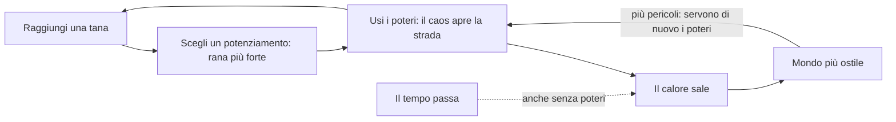

# Frogger 3D — Regole di design

Ultimo aggiornamento: 2026-10-04

## Visione

Una rana con i superpoteri scappa da un incendio che ha preso la sua foresta, e attraversa all'infinito strade, fiumi, ferrovie, aeroporti e porti. Si rafforza nelle tane; il caos che provoca le apre la strada, ma rende il mondo sempre più ostile.

Il Frogger originale parla di una creatura fragile in un mondo indifferente. Qui la rana può reagire, e il mondo reagisce a sua volta: più caos provochi, più il mondo ti dà la caccia.

Riferimenti:

- **Frogger**: gli ostacoli (strada, fiume, coccodrilli) e le tane.
- **Megabonk**: grafica low-poly, potenziamenti durante la run, alta intensità.
- **GTA**: il livello di ricercato, cioè il mondo che reagisce alle tue azioni.
- **Risk of Rain**: la difficoltà sale col tempo e non si ferma mai.
- **Left 4 Dead (AI Director)**: l'intensità arriva a ondate, con momenti in cui si respira.
- **Burnout (modalità Crash)**: i tamponamenti a catena come spettacolo.

## Regole decise

Il cuore del gioco è uno scambio: il caos è un attrezzo che apre la strada, e si paga col calore, che non torna mai indietro. La forza invece si guadagna nelle tane.

Il caos serve a passare: auto ribaltate che bloccano una corsia, rottami che fanno da zattera nel fiume, fumo che solleva il deltaplano, un'esplosione che svuota la strada. Ma ogni potere e ogni rottame scaldano il mondo. Il calore sale anche se il giocatore non fa nulla.

| Area | Regola |
| --- | --- |
| Motore | Godot |
| Telecamera | Terza persona, dietro la rana |
| Controlli | Mouse e tastiera. Provvisori: WASD movimento, mouse telecamera, Spazio salto (premuto di nuovo in aria e tenuto: deltaplano), tasto sinistro pugno, tasto destro super salto, E lingua-rampino e Ctrl in aria schianto sismico (tutti e due solo se sbloccati nella tana), Esc pausa (Riprendi o Abbandona la run), F1 modalità prova, F3 contatore delle prestazioni |
| Movimento | Libero, non su griglia |
| Grafica | 3D low-poly in stile Megabonk, modelli fatti in Blender. Stile scelto: PS1 sgranato, ammorbidito il 5 ottobre 2026 dopo un parere esterno che lo trovava eccessivo (pixel di 2 a 720p invece di 3, 40 livelli di colore invece di 24, retinatura al 60%); gli altri, Base e Arcade, restano disponibili con F2. Tutti i materiali vengono da una tavolozza per stile, scelti per nome del materiale. I modelli si costruiscono con assets/models/build_models.py (Blender): ogni modello ha il suo .blend da ritoccare a mano e il .glb per Godot |
| Ferrovia | Da 1 a 3 binari. Il treno (locomotiva e 3-5 vagoni tra carri chiusi, alti, e pianali, bassi) è l'unico veicolo che non diventa mai rottame: travolge auto e rottami e toglie 60 di vita alla rana; sul tetto si viaggia sicuri. Avviso leale: le luci dei pali lampeggiano 2,5 s prima che il muso entri nella zona di gioco, e l'avviso non cala col calore; il calore rende i treni più veloci solo fino al +30% |
| Aeroporto | Dalla terza sezione. Rifatto il 5 ottobre 2026: **il cielo è pericoloso**. Gli aerei di linea, enormi, non diventano mai rottami e **atterrano** sulla pista, uno dopo l'altro: arrivano da fuori a 14 m di quota e scendono lungo una rampa (14 m/s, fino a +30% col calore) fino al punto di contatto, diverso ogni volta (fra 8 e 50 m dentro la zona di gioco). Sotto l'aereo in volo, a terra, si passa; chi salta o vola sulla sua rotta ci finisce contro (35). Si legge dall'ombra sulla pista, che si allarga quando l'aereo è alto, e da una fila di luci rosse che lampeggia di traverso nel punto di contatto: da lì in poi la pista è pericolosa a terra. Al contatto scintille e fumo dalle gomme; poi frena (fino a 7 m/s) coi motori al contrario, che soffiano in avanti (10 m/s) e spazzano rana e bagagli; poi rulla come prima: fusoliera, motori e carrelli travolgono, sotto le ali si passa, su ali e fusoliera si sta sicuri, dietro ogni motore la fiamma (60 al secondo) e il getto che spinge (fino a 16 m/s), scaglia rottami e bagagli e fa da ascensore al deltaplano. Accanto alla pista due strade di servizio con i trenini bagagli, ora fitti (uno ogni 10-22 m): il getto porta via il carico e lo scaglia; un bagaglio che arriva addosso veloce toglie 10; il pugno fa volare i bagagli |
| Porto | Dalla terza sezione. Una banchina, una corsia d'acqua ferma larga 14 m (due corsie, con navi in versi opposti, dalla quinta sezione) e una banchina sicura; tra due corsie un molo. L'acqua ha le regole del fiume. Le navi portacontainer (circa 41 x 10 m, 3-5 m/s) passano una dopo l'altra come tronchi enormi: si sale col salto normale (ponte a 0,7 m); il ponte di comando a poppa e il castello di prua sono troppo alti. Sul ponte i container stanno in 20 caselle (5 lungo la nave, 4 di traverso) e si impilano: muri alti 2,6 m, un labirinto. Le navi arrivano già in parte cariche (dal 20% al 45% delle caselle, con la distanza). La prua spinge e non fa male. Su ogni corsia due gru a portale, una per metà, con le gambe sulle banchine; il carrello scorre lungo il braccio, così il container può cadere su qualunque casella. La gru insegue la casella mentre la nave avanza: l'ombra, disegnata sulla casella e in viaggio con la nave, lampeggia mentre la gru insegue e resta accesa fissa negli ultimi 0,6 s (0,45 al calore massimo), quando la gru si blocca. Avviso 1,5 s (1,1 al calore massimo); il container è spinto giù e cade in circa 0,7 s; toglie 50 e resta sulla nave. In acqua affonda. Sotto il livello 3 di calore le gru caricano seguendo lo schema: mai sulla casella della rana, e lasciando sempre un passaggio tra le caselle vuote (fino al 40-60% delle caselle, poi impilano). Dal livello 3 la gru più vicina a dove sarà la rana le dà la caccia quando è su una nave |
| Veicoli | Quattro tipi: utilitaria, berlina, furgone, camion (danno 20, 25, 30, 40). Ruote che girano, fari e fanali che si accendono di notte, collisione su misura (si sta sul cofano; la cabina del camion è più bassa del rimorchio) |
| Interfaccia | Un tema unico (scripts/ui_theme.gd); dal 5 ottobre 2026 ogni riquadro (pulsanti, pannelli, carte, tessere, poteri, barre) ha gli angoli smussati a 45° invece che arrotondati, sfaccettati come i modelli, bordi netti senza sfumature e niente ombre morbide: una via di mezzo "da console" fra l'interfaccia moderna e il filtro PS1 (UiTheme.box). Il tema è dato al nodo radice di ogni schermata, con varianti per nome invece di ritocchi a mano. Font: Lilita One per titoli e pulsanti, Nunito per i testi (licenza OFL, in assets/fonts con le licenze). Colori: nero caldo per i pannelli, testo crema, oro per mosche e selezione, verde rana per l'azione principale, rosso fuoco per pericoli e azioni che non si annullano; gli attrezzi hanno il loro colore (guantoni rossi, molle verdi, ala arancione, corpo verde acqua, lingua rosa). L'interfaccia si adatta alla risoluzione (base 1280x720), e i pixel dello stile PS1 crescono con lei. Il menu iniziale sta sopra il gioco vivo: dietro c'è la partita vera, col traffico che passa, l'incendio fermo all'orizzonte e la telecamera che gira piano attorno alla rana; Gioca fa partire la run sul posto (la telecamera torna dietro la rana, compare l'HUD). Ricomincia dalla fine della corsa parte subito, senza menu. Gli attrezzi hanno un'icona disegnata da codice (scripts/slot_icon.gd: guantone, molla, ala a delta, goccia, lingua; più freccia per i numerici, anelli per le fusioni, mosca e mosca d'oro). Le carte della tana hanno banda e bordo nel colore dell'attrezzo, il nome grande, quanto dura (slot fino a fine run, si somma n di 3, fusione) e il tasto; entrano una dopo l'altra. Lo stagno: statistiche a tessere raggruppate per attrezzo (corpo, molle, guantoni, ala, lingua per le mosche, poi quelle generali) coi livelli a pallini; la maestria a schede per carta, con la barra di avanzamento di ogni prova; Esc chiude. L'HUD: in alto a sinistra la vita (pulsa sotto il 30%) e il calore a cinque gradini dal giallo al rosso scuro (lampeggia a ogni livello nuovo); in alto a destra distanza, tana, record e mosche; in basso a sinistra i poteri, ognuno col colore e l'icona del suo attrezzo, il tasto, il modificatore equipaggiato e la ricarica (lampeggia quando torna pronto); in basso al centro la fiamma e i metri dall'incendio (pulsa quando è vicino); in basso a destra il corpo e i potenziamenti numerici. Niente scritte da sviluppo: F2 si legge nel menu. La fine della corsa mostra la distanza in grande, il record, tane, tempo e calore, e le mosche guadagnate |
| Sfondo | Montagne all'orizzonte e una pianura sotto il piano di gioco, che seguono la rana; ai lati alberi, case e lampioni |
| Colori e calore | Il calore sposta l'ora del giorno come nel dinosauro di Google: giorno, tramonto, notte; lampo invertito a ogni nuovo livello. Di notte le minacce restano leggibili (nello stile arcade brillano) |
| Personaggio | Una rana con gli attrezzi: guantoni da boxe grandi, molle sotto le zampe, deltaplano a delta a strisce con telaio, che si apre e si chiude con un'animazione. Il modello è di Blender (build_frog in build_models.py), a pezzi rigidi come i personaggi della PS1: busto col ventre chiaro e le macchie, testa con bocca e narici, occhi sfaccettati, gola, cosce coi piedi palmati e le molle, braccia e guantoni; ogni pezzo ha l'origine nella sua articolazione, così il codice lo può muovere. Le braccia vanno sempre dalla spalla al guantone: quando il pugno scatta si allungano come elastici. Le carte cambiano colore solo alla parte giusta (guantoni, molle, pelle). Animazioni da codice (scripts/frog_animator.gd), che accompagnano i gesti senza mai anticiparli: in salto il corpo si inclina col volo e le zampe spingono salendo e si raccolgono scendendo; col deltaplano si piega in curva e le zampe penzolano; in acqua scalcia; la gola pulsa, le palpebre sbattono e dopo 4 s ferma tira pugni all'aria. Le pose vanno a scatti come sulla PS1, 15 al secondo (scelto il 5 ottobre 2026; il movimento nel mondo resta fluido); dalla modalità prova si possono rendere fluide per confronto. L'occhiata della rana verso l'incendio è stata provata e scartata |
| Animazioni | Fermo-immagine di 110 ms solo quando il pugno colpisce un'auto, con il guantone già disteso, lampo d'impatto e scossa della telecamera; rallentatore e telecamera larga sulle catene di 4 o più rottami vicino alla rana; schiacciamento e allungamento della rana; sospensioni e sobbalzo di spavento delle auto; scintille e fumo dai rottami |
| Ostacoli | Autostrada, fiume, coccodrilli |
| Poteri | Super salto, pugno alle macchine, deltaplano: poteri base, disponibili da subito; in futuro poteri nuovi o potenziamenti di quelli base |
| Struttura della run | Infinita: si gioca finché non si muore |
| Giocatori | Singleplayer per ora; multiplayer cooperativo possibile in futuro |
| Bordi | La zona di gioco è larga 74 m; ai lati, muri invisibili e un bordo che si vede, diverso per bioma. Il bordo taglia di traverso le corsie, quindi dove le corsie continuano è una struttura da cui entrano ed escono: gallerie sulle strade (le auto nascono dentro, al buio, e non compaiono più dal nulla), ponti di pietra sui fiumi (tronchi e coccodrilli passano sotto), i portali della linea elettrica sulla ferrovia (i treni passano sotto e si vedono ancora arrivare dall'orizzonte), luci blu di bordo all'aeroporto, il molo che finisce al porto (oltre c'è solo acqua), una siepe sulle strisce sicure, alla partenza e alle tane. Chi viene schiacciato contro il bordo da qualcosa che si muove (il ponte di comando di una nave, una prua, un tronco di lato) perde 25 di vita e viene spostato di lato, nel primo punto libero |
| Incendio | Un muro di fuoco insegue la rana su tutta la larghezza: parte 40 m dietro, avanza da 1,2 m/s (calore zero) a 4 m/s (calore massimo) e **accelera col tempo**: +0,2 m/s per ogni minuto di inseguimento, fino a 7,5 m/s (al 15° minuto corre come la rana che cammina). Deciso il 5 ottobre 2026: prima non faceva mai perdere. Sull'acqua (fiumi, porto) corre al 60%. Non resta mai più di 40 m indietro; raggiunta una tana viene respinto a 40 m, ma la velocità raggiunta resta. Chi ci finisce dentro perde 80 di vita al secondo. Le auto raggiunte diventano rottami, che non scaldano e non fanno catena. Si sente dal bagliore arancione sulla strada davanti, dal fumo che passa sopra la rana e dall'HUD ("Fuoco: N m", col bordo dello schermo che si arrossa sotto i 25 m). Velocità da tarare giocando |
| Tana | Uno stagno sul prato (modello di Blender, build_den, dal 5 ottobre 2026 al posto della porta dorata): un laghetto per lato (acqua bassa chiara sul bordo e profonda più scura al centro, cerchi d'increspatura che si allargano piano attorno ad alcune ninfee) con ninfee, fiori rosa, sassi e canne, le pietre del passaggio al centro e, sopra il passaggio, l'arco di due grandi tife che si incrociano, da vedere arrivare da lontano. Solo da vedere: si cammina ovunque, e il traguardo è la striscia intera. **L'arrivo** (5 ottobre 2026): i fiori sono boccioli finché la rana non entra, poi si aprono uno dopo l'altro e dai laghetti si alza uno sciame di lucciole; la rana si ferma subito (perde lo slancio in avanti e ricade nello stagno: anche arrivando lanciata da un super salto o da un volo non attraversa la tana), si gira verso la telecamera, fa un saltello e alza i guantoni con gli occhi socchiusi, la telecamera si allarga; dopo 0,9 s arrivano le carte. Fiori e lucciole restano vivi anche a gioco fermo, mentre si sceglie. Checkpoint lungo il percorso, non la fine: salva il record su disco e diventa il punto di ripartenza se si cade fuori dal mondo, ma la morte chiude la run |
| Power-up | Si scelgono nelle tane, uno tra tre, a gioco fermo. Gli slot sono gli attrezzi della rana (guantoni, molle, ala, corpo, lingua): un modificatore per slot, e una volta scelto resta per tutta la run: la tana non offre più carte per uno slot occupato (deciso il 4 ottobre 2026). I potenziamenti numerici non hanno slot e si sommano fino a 3 volte. Niente livelli dei modificatori, per ora (deciso il 4 ottobre 2026). **Fusioni**: quando sono equipaggiati entrambi i modificatori di una fusione, la tana successiva la offre di sicuro; la fusione non sostituisce niente: occupa i due slot e tiene gli effetti di tutti e due più il suo. I tre freni contro un gioco troppo facile: slot, scelta tra tre, calore |
| Power-up attuali | Guantoni: **guantoni esplosivi** (l'auto colpita esplode al primo urto con un veicolo, o dopo 1,2 s: le auto nel raggio di 6 m diventano rottami e volano; la rana entro 4,5 m perde 30), **montante** (il pugno solleva le auto: volano e ricadono su altre), **guantone a molla** (il pugno arriva a 4 m). Molle: **molle-trampolino** (sui tetti delle auto si rimbalza da soli, 2,5 m), **schianto sismico** (in aria, Ctrl: si piomba giù e all'atterraggio un'onda di 6 m ribalta e fa volare le auto; +2 di calore; un pulsante a sé, non scatta dopo il super salto). Ala: **correnti calde** (il fumo dei rottami solleva come un ascensore e la carica non si consuma; il fumo dura 6 s), **ala a reazione** (deltaplano a 16 m/s invece di 10, ma +1,5 di calore al secondo in volo). Corpo: **pelle impermeabile** (l'acqua non toglie vita). Lingua: **lingua-rampino** (quando è pronta, un mirino segna la cosa che aggancerebbe: la più vicina nella direzione della telecamera entro 12 m. E aggancia; tenendo premuto la lingua si accorcia fino a 2,5 m e fa da fune: auto, tronchi, navi, treni e aerei trascinano la rana; lasciando, la rana vola via con lo slancio. Un rottame invece viene tirato verso la rana finché si tiene premuto. Funziona anche dall'acqua; si stacca prima del bordo; +1 di calore). Fusioni: **Napalm** (guantoni esplosivi + correnti calde: i rottami fumano 15 s e le colonne di fumo sono più larghe), **Terremoto** (montante + schianto sismico: onda di 10 m, auto scagliate più in alto). Numerici: pugno più forte, molle rapide, ala più grande, pelle dura |
| Fine della run | Quando la vita finisce: schermata con distanza, tane, tempo, calore massimo e record; Invio o il pulsante fanno ricominciare da zero. Abbandonare la run dalla pausa vale come una fine: record, mosche e prove delle carte contano, e si torna al menu |
| Percorso | Infinito, a sezioni: strade, fiumi, ferrovie (dalla seconda sezione), aeroporti e porti (dalla terza), separati da strisce sicure, poi una tana. Dal 5 ottobre 2026 le sezioni sono più lunghe, per bilanciare: 4-5 ostacoli nella prima e uno in più a sezione fino a 8-9 (circa 75 m alla prima tana, 100 alla seconda, 150 alla terza, 270 dalla quinta in poi; prima erano 45, 65, 105 e 180), regolabili da Course (section_obstacles, section_growth_cap). Ogni sezione ha più corsie e veicoli e correnti più veloci; i fiumi hanno sempre terra su entrambi i lati. Muri invisibili ai lati della zona di gioco |
| Calore | Un'unica barra da 0 a 100 in 5 livelli, per strada e palude insieme; sale di continuo col tempo (0,15 al secondo); i poteri (pugno +1, deltaplano +2, super salto +3) e ogni rottame entro 50 m dalla rana (+0,6: conta il caos che si vede, non quello di un aeroporto lontano) lo fanno salire più in fretta; non cala mai. Effetti al massimo: veicoli e correnti più veloci (+80% e +40%), veicoli un po' più radi (+25% di spazio): meno auto ma più veloci, così il traffico minaccia invece di ingorgarsi, frenata -60%, schianti più facili; dal 60% le auto perdono il controllo da sole. Al massimo 80 rottami insieme |
| Ritmo | Ondate di pericolo sopra una base che cresce sempre |
| Genere | Roguelite con run infinite (deciso il 4 ottobre 2026). La run è infinita, ma l'incendio che insegue la rana la chiude: una buona run dura fra i 15 e i 20 minuti. Fra una run e l'altra si sbloccano opzioni con le imprese, si scelgono rane con attrezzi di partenza diversi, e con le mosche raccolte (la valuta, sopra le cose che si muovono) si compra forza permanente, come in Vampire Survivors: statistiche e carte migliorate. Dettagli in docs/imprese.md |
| Ricompensa | La forza si guadagna nelle tane, scegliendo un potenziamento. Il caos non dà forza (decisione del 4 ottobre 2026, "per ora"): è un attrezzo per passare e costa calore |
| Pubblicazione | Il gioco si pubblica comunque, senza budget: esce quando è pronto. Il nome definitivo verrà più avanti, prima della pagina Steam ("Frogger" è un marchio di Konami) |
| Vita | Vita e potenziamenti che crescono durante la run, dalle tane; auto, acqua e coccodrilli tolgono vita: un solo colpo non basta a perdere |
| Sconfitta | Colpito dalle macchine (anche quelle che hai colpito tu), mangiato dal coccodrillo, caduto in acqua |
| Traffico | Ibrido: le auto guidano in modo cinematico e diventano rottami fisici quando vengono colpite forte; un rottame che colpisce un'auto la trasforma a sua volta. Con il calore alto il traffico passa alla fisica e diventa instabile da solo. I veicoli frenano davanti agli ostacoli e si formano code; se non fanno in tempo a fermarsi si schiantano. I rottami spariscono dopo 25 s |
| Tetto dei veicoli | Si può stare sul tetto: non fa danno e la rana viene trasportata, come su un tronco |
| Sbalzo | Un veicolo che colpisce la rana la butta di lato, fuori dalla corsia, anche nella corsia accanto |
| Acqua | Sulla superficie dei fiumi scorrono scie azzurre chiare alla velocità e nel verso di ogni corrente: si legge dove e quanto in fretta va l'acqua (sull'acqua ferma del porto sono onde corte che dondolano sul posto). Chi cade in acqua galleggia, nuota lento, segue la corrente e perde 20 di vita al secondo. Per uscire serve un salto tenuto premuto |
| Rottami nel fiume | Galleggiano e seguono la corrente: un'auto lanciata nel fiume diventa una zattera |
| Coccodrilli | La schiena è sicura; la bocca si apre a intervalli e morde. Modello di Blender (build_crocodile): corpo e coda rastremati con le creste, zampe di lato, occhi gialli sul collo, narici e denti; la mascella superiore ruota sul suo attacco |
| Tronchi | Modello di Blender (build_log): sette facce con una piatta in cima, teste chiare ad anelli, un moncone col muschio; la corteccia si allunga da codice fino alla lunghezza del tronco (6-11 m) |
| Urti | Fa male solo un veicolo che ti viene addosso: chi viaggia insieme a un veicolo, sopra o accanto, non si fa male, e nemmeno chi sbatte contro un veicolo fermo. I rottami che galleggiano sono zattere e non fanno mai male |
| Caos | Deve essere emergente: nasce da regole semplici che si incrociano, non da eventi scritti a mano |

## Difficoltà nei biomi

Decisa il 4 ottobre 2026. Due assi con due compiti diversi:

| Asse | Cosa cambia | Quando si legge |
| --- | --- | --- |
| Distanza (la sezione) | La **quantità**: più corsie, binari, navi, aerei più frequenti. È la struttura del blocco | Quando il blocco nasce |
| Calore | Il **comportamento**: qualcosa che prima non succedeva | Dal vivo, anche nei blocchi già creati |

Un **gradino di calore** è un comportamento nuovo che si sblocca a una soglia. Regole:

1. È un comportamento, non un numero: "il treno va più veloce" non è un gradino, "il treno passando risucchia la rana" sì.
2. Ha un avviso leale, col linguaggio visivo del gioco: luci che lampeggiano, ombra rossa, fiamma.
3. Scatta subito, anche nei blocchi già in campo.
4. Aggiunge alla regola del bioma senza cancellarla.

Nessun annuncio nell'HUD (deciso il 4 ottobre 2026: il pannello "La soglia del caos" era invasivo e non serviva); resta solo il messaggio del nuovo livello di calore.

Per ora **un gradino per bioma, tutti al livello 3** (60 di calore): "la soglia del caos". Un secondo gradino solo dopo aver provato il primo. Gli aumenti numerici esistenti restano, ma non contano come difficoltà.

| Bioma | Distanza | Gradino al livello 3 | Stato |
| --- | --- | --- | --- |
| Strada | più corsie, più veloci | le auto perdono il controllo da sole | fatto |
| Fiume | più correnti, più coccodrilli | i tronchi affondano: con la rana sopra (anche in aria appena sopra: saltellare non basta) tremano, dopo 1 s cominciano ad affondare facendo bolle e vanno sotto in 2 s; quando la rana scende tornano a galla. I coccodrilli no | fatto |
| Ferrovia | più binari | il rapido: metà dei treni, bianco, locomotiva e due carrozze, 55 m/s (il doppio). Stesso avviso di 2,5 s. La sua scia, dal muso a 12 m dopo la coda, tira verso i binari chi sta entro 3 m dalla fiancata, fino a 9 m/s (di più vicino); camminando ci si allontana | fatto |
| Aeroporto | aerei più frequenti: da uno ogni 9-15 s fino a 6-10 s (dalla quarta sezione di aeroporti in poi) | **l'atterraggio di pancia** (5 ottobre 2026, al posto del decollo): metà degli aerei ha i carrelli ceduti; già in volo perde fumo nero da un motore, tocca terra appena entrato e scivola basso e storto su tutta la pista (20 m/s che calano), con scintille e chiazze di fuoco dietro di sé ogni 4 m (50 al secondo, si spengono in 3,5 s). Sotto le ali non si passa più: l'ala bassa colpisce la rana e spazza i trenini, scagliando il carico | fatto |
| Porto | una corsia, poi due; navi più cariche | la gru caccia la rana sul ponte | fatto |

## Roadmap

Ogni passo si aggiunge solo quando il precedente è divertente. L'ordine dei passi da fare è una proposta e si può riordinare.

### Dove siamo (4 ottobre 2026)

Il gioco base è finito e giocabile: una run infinita in cui si muore e si ricomincia. Sopra il gioco base ci sono già i modelli in Blender, i power-up nelle tane e tre biomi. È un bel giocattolo; per essere un gioco da pubblicare gli mancano soprattutto una ragione per rigiocare, abbastanza power-up da costruire build diverse, il suono e la cornice (menu, opzioni, inglese).

### Fatto

| Passo | Cosa c'è |
| --- | --- |
| Gioco base | Rana in terza persona, strade con traffico ibrido (auto cinematiche che diventano rottami fisici), fiumi con tronchi e coccodrilli, vita, percorso infinito a sezioni con le tane, calore, fine della run e record su disco |
| Poteri | Pugno, super salto, deltaplano, ognuno come nodo separato della rana |
| Grafica | Modelli low-poly in Blender, stile PS1 (più Base e Arcade con F2), il giorno che scende verso la notte col calore, fermo-immagine e rallentatore sulle catene di rottami |
| Power-up nelle tane | Scelta uno tra tre (quattro con "Più scelta") a gioco fermo; slot-attrezzo (guantoni, molle, ala, corpo, lingua). Fatti: nove modificatori, due fusioni e quattro numerici (elenco nella riga "Power-up attuali") |
| Biomi | Ferrovia (treni inarrestabili, avviso leale); aeroporto (fiamma e getto dei motori, trenini bagagli il cui carico vola via nel getto, il getto come ascensore per il deltaplano); porto (acqua e navi portacontainer: le gru caricano le navi mentre ci sei sopra, un labirinto che si chiude; dal livello 3 cacciano la rana) |
| Difficoltà nei biomi | Criteri decisi (sezione sopra); un gradino al livello 3 in ogni bioma: auto che sbandano, tronchi che affondano, il rapido, il decollo, le gru che cacciano |
| Strumenti | 24 test automatici (tests/run.sh), screenshot senza finestre (tools/screenshot.sh, anche delle schermate: menu, stagno, carte, pausa, fine) e la modalità prova per giocare (F1 in gioco, oppure tools/prova.sh) |

### Da provare giocando

Per arrivarci subito c'è la **modalità prova**: in gioco F1 apre un pannello (livello di calore, calore bloccato, salto a un bioma, invincibile, poteri sempre carichi, incendio fermo, una tana a richiesta, qualsiasi power-up equipaggiato subito); oppure si avvia già pronti, per esempio `tools/prova.sh --bioma=aeroporto --calore=3 --blocca-calore --invincibile`. Una run di prova non salva il record.

- Il porto nuovo: salire sulla nave, attraversare il labirinto di container, leggere l'ombra sulla casella; dal livello 3 di calore la gru che dà la caccia.
- L'aeroporto rifatto (5 ottobre): leggere ombra e luci, scegliere dove attraversare (sotto l'aereo in volo, dopo il contatto, in volo), i motori al contrario, i trenini fitti; dal livello 3 l'atterraggio di pancia.
- I bagagli scagliati dal getto: ora più frequenti, e spazzati anche dai motori al contrario e dall'ala della pancia.
- Il calore che ora conta solo i rottami entro 50 m dalla rana.
- L'incendio, ora che accelera (1,2-4 m/s col calore, +0,2 m/s al minuto, fino a 7,5): se fa davvero perdere e quando, se la run dura 15-20 minuti, se si capisce da dietro. Per provarlo da fermi: `tools/prova.sh --calore=5 --blocca-calore`.
- Le sezioni più lunghe (5 ottobre): se il ritmo delle tane, e quindi dei power-up, è giusto; se l'incendio, che fra una tana e l'altra non viene respinto, ora fa più paura.
- I gradini al livello 3 di calore: i tronchi che affondano, il rapido e la sua scia, l'atterraggio di pancia, le gru che cacciano.

### Il percorso verso l'uscita

Il gioco si pubblica comunque, senza budget: quattro fasi, e si passa alla successiva quando il criterio è soddisfatto.

| Fase | Cosa | Criterio per passare oltre |
| --- | --- | --- |
| 1. È un gioco | I punti qui sotto | 5-10 persone esterne lo provano e vogliono rigiocare |
| 2. Pagina Steam | Il nome, le immagini, un trailer di 30-60 s, clip brevi con costanza | Le wishlist crescono da sole |
| 3. Demo | I primi minuti, per una Steam Next Fest (tre all'anno) | Chi prova la demo la rigioca e mette il gioco in wishlist |
| 4. Uscita | Accesso anticipato o versione completa, a 5-8 € | — |

### Fase 1: da fare, in ordine

Decisa il 4 ottobre 2026.

1. **I gradini di calore** (sezione "Difficoltà nei biomi"): fatti tutti e cinque il 4 ottobre 2026, da provare giocando. Resta la seconda fase del porto, dopo averlo provato: la nave che si inclina col carico (fino a circa 10°) e i container che scivolano in acqua e galleggiano; qui il pugno trova un ruolo, spostare il peso.
2. **L'incendio che insegue** (fatto il 4 ottobre 2026, da tarare giocando; regole nella riga "Incendio"): la spinta ad andare avanti e la fine della run insieme. La rana scappa da un incendio partito nella sua foresta.
   - Un muro di fuoco avanza dietro la rana su tutta la larghezza; **il caos alimenta l'incendio**: la sua velocità sale col calore, lento a calore basso, più veloce di un giocatore prudente al massimo. È lui a chiudere la run fra i 15 e i 20 minuti.
   - Se raggiunge la rana brucia, come la fiamma dei motori: in pratica è la fine.
   - Si comunica in tre modi, perché la telecamera guarda avanti: il bagliore arancione sulla strada davanti alla rana, che cresce quando il fuoco si avvicina; il fumo che arriva da dietro e passa sopra la rana; nell'HUD la distanza dal fuoco, col bordo dello schermo che si arrossa quando è vicino. Più avanti il crepitio.
   - La tana è un rifugio: quando la si raggiunge, il fuoco viene respinto a una distanza fissa. Dopo ogni sezione si respira (le "ondate" senza un sistema a parte).
   - Il fuoco che raggiunge le auto le fa diventare rottami in fiamme; sui fiumi l'incendio rallenta.
3. **I bordi visibili** (fatto il 4 ottobre 2026; regole nella riga "Bordi"). Da decidere se sono anche attivi come nel Frogger classico (chi viene portato fuori da un tronco o da una nave muore).
4. **Power-up e fusioni** (primo gruppo fatto il 4 ottobre 2026: lingua-rampino, schianto sismico, montante, guantone a molla, molle-trampolino, ala a reazione, pelle impermeabile; fusioni Napalm e Terremoto). Niente livelli per ora. Da allargare verso 15-20 power-up, dal catalogo in idee-future.md.
5. **Mosche e stagno** (fatto il 4 ottobre 2026): le mosche sopra le cose che si muovono, lo stagno con le statistiche, la maestria delle carte (miglioramenti speciali sbloccati da prove e attivati con le mosche d'oro), il menu iniziale. Dettagli in docs/imprese.md.
6. **Sblocchi a imprese e rane diverse**: deciso il mazzo delle tane che parte ridotto e si allarga con le imprese, e le rane con un pro e un contro. Le imprese, gli sblocchi e le rane li scrive il giocatore in docs/imprese.md; poi si implementano (salvataggio dei progressi, schermata iniziale minima per scegliere la rana e vedere le imprese). Nel frattempo tutte le carte restano nel mazzo, e la modalità prova equipaggia qualsiasi power-up per provare il gioco completo.
7. **La cornice**: opzioni (audio, grafica, tasti), testi in inglese, controller, un tutorial per il primo minuto (il menu iniziale e la pausa ci sono già). Il tema unico e l'adattamento alla risoluzione sono fatti (riga "Interfaccia"); fatti anche il menu sopra il gioco vivo, le carte e lo stagno coi colori degli attrezzi e l'HUD ripulito. Interfaccia decisa il 4 ottobre 2026: menu sopra il gioco vivo, gli attrezzi della rana come codice di colori e icone (guantoni rossi, molle verdi, ala arancione, corpo verde acqua, lingua rosa) in carte, stagno, maestria e HUD, la segnaletica solo per avvisi e pericoli; un tema unico e l'interfaccia che si adatta alla risoluzione.
8. **Suono**: effetti in stile retrò (generati con strumenti come sfxr, o da librerie CC0), poi musica CC0 o con solo il credito.
9. **Prova esterna** con 5-10 persone.

**L'aeroporto, rifatto il 5 ottobre 2026** (riga "Aeroporto"): gli aerei atterrano, a terra sotto di loro si passa e in volo no, dal livello 3 atterrano di pancia. Da provare giocando. La proposta precedente ("la strada dei giganti") resta in idee-future.md.

**Dopo la fase 1: i mondi.** Ogni tot tane il mondo cambia (città, zona industriale, ...), e più avanti si sceglie fra due mondi finali come in Binding of Isaac: **il calore sceglie la strada** (calore basso: paradiso; alto: inferno). Il caos che hai provocato decide dove finisci.

Dopo la fase 1, o quando servono: **reazioni del mondo** (auto che danno la caccia, coccodrilli aggressivi), **altri biomi** (lago ghiacciato, città con semafori, palude) e forse il bivio nella tana. Il **multiplayer** cooperativo solo dopo l'uscita, se lo facciamo.

## Domande aperte

Nessuna per ora. Le risposte alle domande precedenti sono nella tabella "Regole decise".
