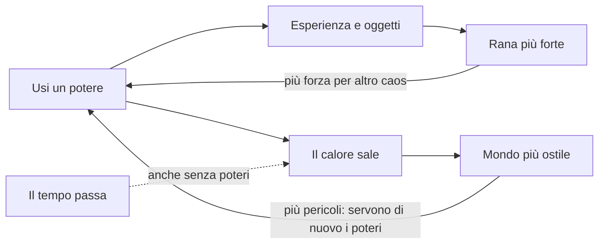

# Frogger 3D — Regole di design

Ultimo aggiornamento: 2026-10-01

## Visione

Una rana con i superpoteri attraversa all'infinito strade e fiumi. Il caos che provoca le dà forza, ma rende il mondo sempre più ostile.

Il Frogger originale parla di una creatura fragile in un mondo indifferente. Qui la rana può reagire, e il mondo reagisce a sua volta: più caos provochi, più il mondo ti dà la caccia.

Riferimenti:

- **Frogger**: gli ostacoli (strada, fiume, coccodrilli) e le tane.
- **Megabonk**: grafica low-poly, esperienza e oggetti durante la run, alta intensità.
- **GTA**: il livello di ricercato, cioè il mondo che reagisce alle tue azioni.
- **Risk of Rain**: la difficoltà sale col tempo e non si ferma mai.
- **Left 4 Dead (AI Director)**: l'intensità arriva a ondate, con momenti in cui si respira.
- **Burnout (modalità Crash)**: tamponamenti a catena come fonte di punti.

## Regole decise

Il cuore del gioco è uno scambio: ogni potere usato ti rende più forte ma accelera l'ostilità del mondo, che non torna mai indietro.

Il calore sale anche se il giocatore non fa nulla; i poteri lo accelerano, ma sono anche l'unico modo di diventare più forti.

| Area | Regola |
| --- | --- |
| Motore | Godot |
| Telecamera | Terza persona, dietro la rana |
| Controlli | Mouse e tastiera. Provvisori: WASD movimento, mouse telecamera, Spazio salto (premuto di nuovo in aria e tenuto: deltaplano), tasto sinistro pugno, tasto destro super salto, Esc pausa |
| Movimento | Libero, non su griglia |
| Grafica | 3D low-poly in stile Megabonk, modelli fatti in Blender. Stile scelto: PS1 sgranato (gli altri, Base e Arcade, restano disponibili con F2). Tutti i materiali vengono da una tavolozza per stile, scelti per nome del materiale. I modelli si costruiscono con assets/models/build_models.py (Blender): ogni modello ha il suo .blend da ritoccare a mano e il .glb per Godot |
| Ferrovia | Da 1 a 3 binari. Il treno (locomotiva e 3-5 vagoni tra carri chiusi, alti, e pianali, bassi) è l'unico veicolo che non diventa mai rottame: travolge auto e rottami e toglie 60 di vita alla rana; sul tetto si viaggia sicuri. Avviso leale: le luci dei pali lampeggiano 2,5 s prima che il muso entri nella zona di gioco, e l'avviso non cala col calore; il calore rende i treni più veloci solo fino al +30% |
| Aeroporto | Dalla terza sezione. Aerei di linea in rullaggio, enormi e lenti (7 m/s, fino a +30% col calore), che non diventano mai rottami: fusoliera, motori e carrelli travolgono (35 alla rana), sotto le ali si passa, su ali e fusoliera si sta sicuri. Dietro i motori il getto è un vento fino a 16 m/s che spinge via rana e rottami; col deltaplano aperto solleva e catapulta |
| Porto | Dalla terza sezione. Nastri trasportatori che portano di lato (3-5 m/s) e gru a portale che lasciano cadere container: l'ombra a terra lampeggia 1,5 s prima. Il container che cade toglie 50; a terra resta come ostacolo e piattaforma e i nastri lo trascinano. Più è alto il calore, più spesso la gru mira alla rana |
| Veicoli | Quattro tipi: utilitaria, berlina, furgone, camion (danno 20, 25, 30, 40). Ruote che girano, fari e fanali che si accendono di notte, collisione su misura (si sta sul cofano; la cabina del camion è più bassa del rimorchio) |
| Sfondo | Montagne all'orizzonte e una pianura sotto il piano di gioco, che seguono la rana; ai lati alberi, case e lampioni |
| Colori e calore | Il calore sposta l'ora del giorno come nel dinosauro di Google: giorno, tramonto, notte; lampo invertito a ogni nuovo livello. Di notte le minacce restano leggibili (nello stile arcade brillano) |
| Personaggio | Una rana con gli attrezzi: guantoni da boxe grandi, molle sotto le zampe, deltaplano a delta a strisce con telaio, che si apre e si chiude con un'animazione |
| Animazioni | Fermo-immagine di 110 ms solo quando il pugno colpisce un'auto, con il guantone già disteso, lampo d'impatto e scossa della telecamera; rallentatore e telecamera larga sulle catene di 4 o più rottami vicino alla rana; schiacciamento e allungamento della rana; sospensioni e sobbalzo di spavento delle auto; scintille e fumo dai rottami |
| Ostacoli | Autostrada, fiume, coccodrilli |
| Poteri | Super salto, pugno alle macchine, deltaplano: poteri base, disponibili da subito; in futuro poteri nuovi o potenziamenti di quelli base |
| Struttura della run | Infinita: si gioca finché non si muore |
| Giocatori | Singleplayer per ora; multiplayer cooperativo possibile in futuro |
| Tana | Checkpoint lungo il percorso, non la fine: salva il record su disco e diventa il punto di ripartenza se si cade fuori dal mondo, ma la morte chiude la run |
| Power-up | Si scelgono nelle tane, uno tra tre, a gioco fermo. Gli slot sono gli attrezzi della rana (guantoni, molle, ala, corpo): un modificatore per slot, e uno nuovo sostituisce il precedente. I potenziamenti numerici non hanno slot e si sommano fino a 3 volte. I tre freni contro un gioco troppo facile: slot, scelta tra tre, calore |
| Power-up attuali | Guantoni esplosivi (l'auto colpita esplode al primo urto con un veicolo, o dopo 1,2 s: le auto nel raggio di 6 m diventano rottami e volano; la rana entro 4,5 m perde 30). Correnti calde (col deltaplano, il fumo dei rottami solleva come un ascensore e la carica non si consuma; il fumo dura 6 s). Numerici: pugno più forte, molle rapide, ala più grande, pelle dura |
| Fine della run | Quando la vita finisce: schermata con distanza, tane, tempo, calore massimo e record; Invio o il pulsante fanno ricominciare da zero |
| Percorso | Infinito, a sezioni: strade, fiumi, ferrovie (dalla seconda sezione), aeroporti e porti (dalla terza), separati da strisce sicure, poi una tana. Ogni sezione ha più corsie e veicoli e correnti più veloci; i fiumi hanno sempre terra su entrambi i lati. Muri invisibili ai lati della zona di gioco |
| Calore | Un'unica barra da 0 a 100 in 5 livelli, per strada e palude insieme; sale di continuo col tempo (0,15 al secondo); i poteri (pugno +1, deltaplano +2, super salto +3) e ogni rottame (+0,6) lo fanno salire più in fretta; non cala mai. Effetti al massimo: veicoli e correnti più veloci (+80% e +40%), veicoli un po' più radi (+25% di spazio): meno auto ma più veloci, così il traffico minaccia invece di ingorgarsi, frenata -60%, schianti più facili; dal 60% le auto perdono il controllo da sole. Al massimo 80 rottami insieme |
| Ritmo | Ondate di pericolo sopra una base che cresce sempre |
| Ricompensa | Provocare caos dà esperienza o oggetti, in stile Megabonk |
| Vita | Statistiche e vita che crescono durante la run; auto, acqua e coccodrilli tolgono vita: un solo colpo non basta a perdere |
| Sconfitta | Colpito dalle macchine (anche quelle che hai colpito tu), mangiato dal coccodrillo, caduto in acqua |
| Traffico | Ibrido: le auto guidano in modo cinematico e diventano rottami fisici quando vengono colpite forte; un rottame che colpisce un'auto la trasforma a sua volta. Con il calore alto il traffico passa alla fisica e diventa instabile da solo. I veicoli frenano davanti agli ostacoli e si formano code; se non fanno in tempo a fermarsi si schiantano. I rottami spariscono dopo 25 s |
| Tetto dei veicoli | Si può stare sul tetto: non fa danno e la rana viene trasportata, come su un tronco |
| Sbalzo | Un veicolo che colpisce la rana la butta di lato, fuori dalla corsia, anche nella corsia accanto |
| Acqua | Chi cade in acqua galleggia, nuota lento, segue la corrente e perde 20 di vita al secondo. Per uscire serve un salto tenuto premuto |
| Rottami nel fiume | Galleggiano e seguono la corrente: un'auto lanciata nel fiume diventa una zattera |
| Coccodrilli | La schiena è sicura; la bocca si apre a intervalli e morde |
| Urti | Fa male solo un veicolo che ti viene addosso: chi viaggia insieme a un veicolo, sopra o accanto, non si fa male, e nemmeno chi sbatte contro un veicolo fermo. I rottami che galleggiano sono zattere e non fanno mai male |
| Caos | Deve essere emergente: nasce da regole semplici che si incrociano, non da eventi scritti a mano |

## Gioco base (proposta da discutere)

La prima versione giocabile ha un solo obiettivo: capire se attraversare e prendere a pugni le macchine è divertente anche con dei cubi grigi.

**Dentro:**

- La rana in terza persona che salta, controllata con mouse e tastiera.
- Una strada con più corsie di traffico; le auto hanno la fisica e possono scontrarsi tra loro.
- Un fiume con tronchi e coccodrilli.
- La tana come checkpoint, poi il percorso ricomincia più difficile.
- La vita: auto, acqua e coccodrilli tolgono vita; si perde quando la vita finisce.
- Una sola barra di calore che sale col tempo e rende il traffico più fitto e veloce.
- **Tutti e tre i poteri: pugno, super salto e deltaplano.** Il pugno è la prima fonte di caos; ogni potere usato fa salire il calore.

**Fuori, per ora:**

- Esperienza, oggetti e statistiche: senza niente da comprare non servono.
- Le reazioni del mondo (auto che danno la caccia, coccodrilli aggressivi).
- Grafica e modelli in Blender: si usano forme semplici.

Il gioco base è finito quando si può giocare una run infinita, morire e ricominciare.

## Feature da aggiungere, in ordine

Ogni passo si aggiunge solo quando il precedente è divertente. L'ordine è una proposta e si può riordinare.

1. **Gioco base**: la sezione qui sopra.
2. **Esperienza dal caos**: gli incidenti danno esperienza e le catene di scontri valgono di più delle auto singole. Il passaggio di livello fa scegliere una statistica. Per ora l'esperienza cade a terra e va raccolta tra i rottami, come in Megabonk; si rivede quando si arriva qui.
3. **Reazioni del mondo**: al crescere del calore le auto ti danno la caccia e i coccodrilli diventano aggressivi. Ogni reazione ha un avviso visibile.
4. **Ondate**: picchi di pericolo sopra la base del calore, con momenti di respiro.
5. **Oggetti che cambiano le regole**, non solo i numeri; per esempio un oggetto che dà meno calore ma anche meno esperienza.
6. **Poteri nuovi e potenziamenti** dei tre poteri base.
7. **Modelli low-poly in Blender** e stile grafico definitivo. Si può anticipare in parallelo, ma non prima che il gioco base funzioni.
8. **Multiplayer** cooperativo, se lo facciamo: teniamo aperta la porta, ma per ora si sviluppa e si testa in singleplayer.

## Domande aperte

Nessuna per ora. Le risposte alle domande precedenti sono nella tabella "Regole decise".
