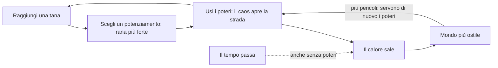

# Frogger 3D — Regole di design

Ultimo aggiornamento: 2026-10-04

## Visione

Una rana con i superpoteri attraversa all'infinito strade, fiumi, ferrovie, aeroporti e porti. Si rafforza nelle tane; il caos che provoca le apre la strada, ma rende il mondo sempre più ostile.

Il Frogger originale parla di una creatura fragile in un mondo indifferente. Qui la rana può reagire, e il mondo reagisce a sua volta: più caos provochi, più il mondo ti dà la caccia.

Riferimenti:

- **Frogger**: gli ostacoli (strada, fiume, coccodrilli) e le tane.
- **Megabonk**: grafica low-poly, potenziamenti durante la run, alta intensità.
- **GTA**: il livello di ricercato, cioè il mondo che reagisce alle tue azioni.
- **Risk of Rain**: la difficoltà sale col tempo e non si ferma mai.
- **Left 4 Dead (AI Director)**: l'intensità arriva a ondate, con momenti in cui si respira.
- **Burnout (modalità Crash)**: i tamponamenti a catena come spettacolo.

## Regole decise

Il cuore del gioco è uno scambio: il caos è un attrezzo che apre la strada, e si paga col calore, che non torna mai indietro. La forza invece si guadagna nelle tane.

Il caos serve a passare: auto ribaltate che bloccano una corsia, rottami che fanno da zattera nel fiume, fumo che solleva il deltaplano, un'esplosione che svuota la strada. Ma ogni potere e ogni rottame scaldano il mondo. Il calore sale anche se il giocatore non fa nulla.

| Area | Regola |
| --- | --- |
| Motore | Godot |
| Telecamera | Terza persona, dietro la rana |
| Controlli | Mouse e tastiera. Provvisori: WASD movimento, mouse telecamera, Spazio salto (premuto di nuovo in aria e tenuto: deltaplano), tasto sinistro pugno, tasto destro super salto, Esc pausa |
| Movimento | Libero, non su griglia |
| Grafica | 3D low-poly in stile Megabonk, modelli fatti in Blender. Stile scelto: PS1 sgranato (gli altri, Base e Arcade, restano disponibili con F2). Tutti i materiali vengono da una tavolozza per stile, scelti per nome del materiale. I modelli si costruiscono con assets/models/build_models.py (Blender): ogni modello ha il suo .blend da ritoccare a mano e il .glb per Godot |
| Ferrovia | Da 1 a 3 binari. Il treno (locomotiva e 3-5 vagoni tra carri chiusi, alti, e pianali, bassi) è l'unico veicolo che non diventa mai rottame: travolge auto e rottami e toglie 60 di vita alla rana; sul tetto si viaggia sicuri. Avviso leale: le luci dei pali lampeggiano 2,5 s prima che il muso entri nella zona di gioco, e l'avviso non cala col calore; il calore rende i treni più veloci solo fino al +30% |
| Aeroporto | Dalla terza sezione. Aerei di linea in rullaggio, enormi e lenti (7 m/s, fino a +30% col calore), che non diventano mai rottami: fusoliera, motori e carrelli travolgono (35 alla rana), sotto le ali si passa, su ali e fusoliera si sta sicuri. Il pericolo è dietro: per 7 m dietro ogni motore una fiamma visibile brucia (60 di vita al secondo); poi il getto, un cono che si allarga fino a 8 m e sale fino a 12 m, reso visibile da strisce d'aria, spinge via la rana (vento fino a 16 m/s) e scaglia i rottami. Sotto le ali, accanto ai motori, corrono due strade di servizio con i trenini bagagli (un trattorino e 2-4 carrelli carichi di valigie e pacchi, 5-8 m/s): non diventano mai rottami, ci si sale sopra, fa male solo il muso del trattorino (15). Quando il getto investe i carrelli porta via il carico e lo scaglia all'indietro a 12-25 m/s, aperto a ventaglio: un bagaglio che arriva addosso veloce toglie 10. Il pugno fa volare i bagagli, anche dai carrelli. Col deltaplano il getto è un ascensore: si sale fino a 10 m/s, si rallenta, il vento spinge la metà e la carica non si consuma (con super salto e deltaplano aperto dentro il getto si arriva a circa 11 m). |
| Porto | Dalla terza sezione. Una banchina, una corsia d'acqua ferma larga 14 m (due corsie, con navi in versi opposti, dalla quinta sezione) e una banchina sicura; tra due corsie un molo. L'acqua ha le regole del fiume. Le navi portacontainer (circa 41 x 10 m, 3-5 m/s) passano una dopo l'altra come tronchi enormi: si sale col salto normale (ponte a 0,7 m); il ponte di comando a poppa e il castello di prua sono troppo alti. Sul ponte i container stanno in 20 caselle (5 lungo la nave, 4 di traverso) e si impilano: muri alti 2,6 m, un labirinto. Le navi arrivano già in parte cariche (dal 20% al 45% delle caselle, con la distanza). La prua spinge e non fa male. Su ogni corsia due gru a portale, una per metà, con le gambe sulle banchine; il carrello scorre lungo il braccio, così il container può cadere su qualunque casella. La gru insegue la casella mentre la nave avanza: l'ombra, disegnata sulla casella e in viaggio con la nave, lampeggia mentre la gru insegue e resta accesa fissa negli ultimi 0,6 s (0,45 al calore massimo), quando la gru si blocca. Avviso 1,5 s (1,1 al calore massimo); il container è spinto giù e cade in circa 0,7 s; toglie 50 e resta sulla nave. In acqua affonda. Sotto il livello 3 di calore le gru caricano seguendo lo schema: mai sulla casella della rana, e lasciando sempre un passaggio tra le caselle vuote (fino al 40-60% delle caselle, poi impilano). Dal livello 3 la gru più vicina a dove sarà la rana le dà la caccia quando è su una nave |
| Veicoli | Quattro tipi: utilitaria, berlina, furgone, camion (danno 20, 25, 30, 40). Ruote che girano, fari e fanali che si accendono di notte, collisione su misura (si sta sul cofano; la cabina del camion è più bassa del rimorchio) |
| Sfondo | Montagne all'orizzonte e una pianura sotto il piano di gioco, che seguono la rana; ai lati alberi, case e lampioni |
| Colori e calore | Il calore sposta l'ora del giorno come nel dinosauro di Google: giorno, tramonto, notte; lampo invertito a ogni nuovo livello. Di notte le minacce restano leggibili (nello stile arcade brillano) |
| Personaggio | Una rana con gli attrezzi: guantoni da boxe grandi, molle sotto le zampe, deltaplano a delta a strisce con telaio, che si apre e si chiude con un'animazione |
| Animazioni | Fermo-immagine di 110 ms solo quando il pugno colpisce un'auto, con il guantone già disteso, lampo d'impatto e scossa della telecamera; rallentatore e telecamera larga sulle catene di 4 o più rottami vicino alla rana; schiacciamento e allungamento della rana; sospensioni e sobbalzo di spavento delle auto; scintille e fumo dai rottami |
| Ostacoli | Autostrada, fiume, coccodrilli |
| Poteri | Super salto, pugno alle macchine, deltaplano: poteri base, disponibili da subito; in futuro poteri nuovi o potenziamenti di quelli base |
| Struttura della run | Infinita: si gioca finché non si muore |
| Giocatori | Singleplayer per ora; multiplayer cooperativo possibile in futuro |
| Tana | Checkpoint lungo il percorso, non la fine: salva il record su disco e diventa il punto di ripartenza se si cade fuori dal mondo, ma la morte chiude la run |
| Power-up | Si scelgono nelle tane, uno tra tre, a gioco fermo. Gli slot sono gli attrezzi della rana (guantoni, molle, ala, corpo): un modificatore per slot, e uno nuovo sostituisce il precedente. I potenziamenti numerici non hanno slot e si sommano fino a 3 volte. I tre freni contro un gioco troppo facile: slot, scelta tra tre, calore |
| Power-up attuali | Guantoni esplosivi (l'auto colpita esplode al primo urto con un veicolo, o dopo 1,2 s: le auto nel raggio di 6 m diventano rottami e volano; la rana entro 4,5 m perde 30). Correnti calde (col deltaplano, il fumo dei rottami solleva come un ascensore e la carica non si consuma; il fumo dura 6 s). Numerici: pugno più forte, molle rapide, ala più grande, pelle dura |
| Fine della run | Quando la vita finisce: schermata con distanza, tane, tempo, calore massimo e record; Invio o il pulsante fanno ricominciare da zero |
| Percorso | Infinito, a sezioni: strade, fiumi, ferrovie (dalla seconda sezione), aeroporti e porti (dalla terza), separati da strisce sicure, poi una tana. Ogni sezione ha più corsie e veicoli e correnti più veloci; i fiumi hanno sempre terra su entrambi i lati. Muri invisibili ai lati della zona di gioco |
| Calore | Un'unica barra da 0 a 100 in 5 livelli, per strada e palude insieme; sale di continuo col tempo (0,15 al secondo); i poteri (pugno +1, deltaplano +2, super salto +3) e ogni rottame entro 50 m dalla rana (+0,6: conta il caos che si vede, non quello di un aeroporto lontano) lo fanno salire più in fretta; non cala mai. Effetti al massimo: veicoli e correnti più veloci (+80% e +40%), veicoli un po' più radi (+25% di spazio): meno auto ma più veloci, così il traffico minaccia invece di ingorgarsi, frenata -60%, schianti più facili; dal 60% le auto perdono il controllo da sole. Al massimo 80 rottami insieme |
| Ritmo | Ondate di pericolo sopra una base che cresce sempre |
| Genere | Roguelite con run infinite (deciso il 4 ottobre 2026). La run è infinita ma la distanza non ha tetto: una buona run finisce fra i 15 e i 20 minuti. Fra una run e l'altra si sbloccano opzioni con le imprese, e si scelgono rane con attrezzi di partenza diversi |
| Ricompensa | La forza si guadagna nelle tane, scegliendo un potenziamento. Il caos non dà forza (decisione del 4 ottobre 2026, "per ora"): è un attrezzo per passare e costa calore |
| Pubblicazione | Il gioco si pubblica comunque, senza budget: esce quando è pronto. Il nome definitivo verrà più avanti, prima della pagina Steam ("Frogger" è un marchio di Konami) |
| Vita | Vita e potenziamenti che crescono durante la run, dalle tane; auto, acqua e coccodrilli tolgono vita: un solo colpo non basta a perdere |
| Sconfitta | Colpito dalle macchine (anche quelle che hai colpito tu), mangiato dal coccodrillo, caduto in acqua |
| Traffico | Ibrido: le auto guidano in modo cinematico e diventano rottami fisici quando vengono colpite forte; un rottame che colpisce un'auto la trasforma a sua volta. Con il calore alto il traffico passa alla fisica e diventa instabile da solo. I veicoli frenano davanti agli ostacoli e si formano code; se non fanno in tempo a fermarsi si schiantano. I rottami spariscono dopo 25 s |
| Tetto dei veicoli | Si può stare sul tetto: non fa danno e la rana viene trasportata, come su un tronco |
| Sbalzo | Un veicolo che colpisce la rana la butta di lato, fuori dalla corsia, anche nella corsia accanto |
| Acqua | Chi cade in acqua galleggia, nuota lento, segue la corrente e perde 20 di vita al secondo. Per uscire serve un salto tenuto premuto |
| Rottami nel fiume | Galleggiano e seguono la corrente: un'auto lanciata nel fiume diventa una zattera |
| Coccodrilli | La schiena è sicura; la bocca si apre a intervalli e morde |
| Urti | Fa male solo un veicolo che ti viene addosso: chi viaggia insieme a un veicolo, sopra o accanto, non si fa male, e nemmeno chi sbatte contro un veicolo fermo. I rottami che galleggiano sono zattere e non fanno mai male |
| Caos | Deve essere emergente: nasce da regole semplici che si incrociano, non da eventi scritti a mano |

## Difficoltà nei biomi

Decisa il 4 ottobre 2026. Due assi con due compiti diversi:

| Asse | Cosa cambia | Quando si legge |
| --- | --- | --- |
| Distanza (la sezione) | La **quantità**: più corsie, binari, navi, aerei più frequenti. È la struttura del blocco | Quando il blocco nasce |
| Calore | Il **comportamento**: qualcosa che prima non succedeva | Dal vivo, anche nei blocchi già creati |

Un **gradino di calore** è un comportamento nuovo che si sblocca a una soglia. Regole:

1. È un comportamento, non un numero: "il treno va più veloce" non è un gradino, "il treno passando risucchia la rana" sì.
2. Ha un avviso leale, col linguaggio visivo del gioco: luci che lampeggiano, ombra rossa, fiamma.
3. Scatta subito, anche nei blocchi già in campo.
4. Aggiunge alla regola del bioma senza cancellarla.

Nessun annuncio nell'HUD (deciso il 4 ottobre 2026: il pannello "La soglia del caos" era invasivo e non serviva); resta solo il messaggio del nuovo livello di calore.

Per ora **un gradino per bioma, tutti al livello 3** (60 di calore): "la soglia del caos". Un secondo gradino solo dopo aver provato il primo. Gli aumenti numerici esistenti restano, ma non contano come difficoltà.

| Bioma | Distanza | Gradino al livello 3 | Stato |
| --- | --- | --- | --- |
| Strada | più corsie, più veloci | le auto perdono il controllo da sole | fatto |
| Fiume | più correnti, più coccodrilli | i tronchi affondano: con la rana sopra (anche in aria appena sopra: saltellare non basta) tremano, dopo 1 s cominciano ad affondare facendo bolle e vanno sotto in 2 s; quando la rana scende tornano a galla. I coccodrilli no | fatto |
| Ferrovia | più binari | il rapido: metà dei treni, bianco, locomotiva e due carrozze, 55 m/s (il doppio). Stesso avviso di 2,5 s. La sua scia, dal muso a 12 m dopo la coda, tira verso i binari chi sta entro 3 m dalla fiancata, fino a 9 m/s (di più vicino); camminando ci si allontana | fatto |
| Aeroporto | aerei più frequenti (da 9-15 s fino a 6-10 s) | il decollo: l'aereo si ferma, la fiamma cresce per 2 s, poi accelera fino a circa 35 m/s con un getto lungo il doppio | da fare |
| Porto | una corsia, poi due; navi più cariche | la gru caccia la rana sul ponte | fatto |

## Roadmap

Ogni passo si aggiunge solo quando il precedente è divertente. L'ordine dei passi da fare è una proposta e si può riordinare.

### Dove siamo (4 ottobre 2026)

Il gioco base è finito e giocabile: una run infinita in cui si muore e si ricomincia. Sopra il gioco base ci sono già i modelli in Blender, i power-up nelle tane e tre biomi. È un bel giocattolo; per essere un gioco da pubblicare gli mancano soprattutto una ragione per rigiocare, abbastanza power-up da costruire build diverse, il suono e la cornice (menu, opzioni, inglese).

### Fatto

| Passo | Cosa c'è |
| --- | --- |
| Gioco base | Rana in terza persona, strade con traffico ibrido (auto cinematiche che diventano rottami fisici), fiumi con tronchi e coccodrilli, vita, percorso infinito a sezioni con le tane, calore, fine della run e record su disco |
| Poteri | Pugno, super salto, deltaplano, ognuno come nodo separato della rana |
| Grafica | Modelli low-poly in Blender, stile PS1 (più Base e Arcade con F2), il giorno che scende verso la notte col calore, fermo-immagine e rallentatore sulle catene di rottami |
| Power-up nelle tane | Scelta uno tra tre a gioco fermo; slot-attrezzo (guantoni, molle, ala, corpo). Fatti: guantoni esplosivi, correnti calde, quattro numerici |
| Biomi | Ferrovia (treni inarrestabili, avviso leale); aeroporto (fiamma e getto dei motori, trenini bagagli il cui carico vola via nel getto, il getto come ascensore per il deltaplano); porto (acqua e navi portacontainer: le gru caricano le navi mentre ci sei sopra, un labirinto che si chiude; dal livello 3 cacciano la rana) |
| Difficoltà nei biomi | Criteri decisi (sezione sopra); gradini fatti: strada e porto |
| Strumenti | 14 test automatici (tests/run.sh) e screenshot senza finestre (tools/screenshot.sh) |

### Da provare giocando

- Il porto nuovo: salire sulla nave, attraversare il labirinto di container, leggere l'ombra sulla casella; dal livello 3 di calore la gru che dà la caccia.
- L'aeroporto: il super salto con il deltaplano nel getto, il momento giusto per attraversare dietro l'aereo.
- I bagagli scagliati dal getto. Prova del giocatore (4 ottobre): non sono un vero problema, e una volta volati via la pista si attraversa facilmente. Da rivedere insieme al gradino del decollo.
- Il calore che ora conta solo i rottami entro 50 m dalla rana.

### Il percorso verso l'uscita

Il gioco si pubblica comunque, senza budget: quattro fasi, e si passa alla successiva quando il criterio è soddisfatto.

| Fase | Cosa | Criterio per passare oltre |
| --- | --- | --- |
| 1. È un gioco | I punti qui sotto | 5-10 persone esterne lo provano e vogliono rigiocare |
| 2. Pagina Steam | Il nome, le immagini, un trailer di 30-60 s, clip brevi con costanza | Le wishlist crescono da sole |
| 3. Demo | I primi minuti, per una Steam Next Fest (tre all'anno) | Chi prova la demo la rigioca e mette il gioco in wishlist |
| 4. Uscita | Accesso anticipato o versione completa, a 5-8 € | — |

### Fase 1: da fare, in ordine

Decisa il 4 ottobre 2026.

1. **I gradini di calore** (sezione "Difficoltà nei biomi"): aeroporto (il decollo, e aerei più frequenti con la distanza), ferrovia (il rapido), fiume (i tronchi che affondano). Poi la seconda fase del porto, dopo averlo provato: la nave che si inclina col carico (fino a circa 10°) e i container che scivolano in acqua e galleggiano; qui il pugno trova un ruolo, spostare il peso.
2. **La fine della run**: la distanza senza tetto. Corsie, velocità, binari e navi continuano a crescere con le sezioni, tarati perché una buona run finisca fra i 15 e i 20 minuti. Niente plateau in cui un giocatore prudente vada avanti per sempre.
3. **Power-up con livelli e fusioni**: riprendere un modificatore lo fa salire di livello (fino al 3); due modificatori precisi insieme si fondono in un terzo più forte (per esempio correnti calde e guantoni esplosivi: "Napalm"). Bastano 15-20 power-up ben fatti, dal catalogo in idee-future.md.
4. **Sblocchi a imprese e rane diverse**: la ragione per rigiocare. Nella run il caos non dà forza, ma certe imprese sbloccano opzioni per le run successive (per esempio una catena di 10 rottami sblocca i guantoni magnetici). Le rane hanno attrezzi di partenza diversi (la pugile, la paracadutista, la saltatrice). Sblocchi di opzioni, mai di forza.
5. **La cornice**: menu, pausa, opzioni (audio, grafica, tasti), testi in inglese, controller, un tutorial per il primo minuto.
6. **Suono**: effetti in stile retrò (generati con strumenti come sfxr, o da librerie CC0), poi musica CC0 o con solo il credito.
7. **Prova esterna** con 5-10 persone.

Dopo la fase 1, o quando servono: **reazioni del mondo** (auto che danno la caccia, coccodrilli aggressivi), **ondate**, **altri biomi** (lago ghiacciato, città con semafori, palude) e forse il bivio nella tana. Il **multiplayer** cooperativo solo dopo l'uscita, se lo facciamo.

## Domande aperte

Nessuna per ora. Le risposte alle domande precedenti sono nella tabella "Regole decise".
