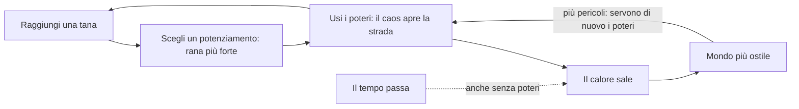

# Frogger 3D — Regole di design

Ultimo aggiornamento: 2026-10-07

## Visione

Una rana con i superpoteri scappa da un incendio che ha preso la sua foresta, e attraversa all'infinito strade, fiumi, ferrovie, aeroporti e porti. Si rafforza nelle tane; il caos che provoca le apre la strada, ma rende il mondo sempre più ostile.

Il Frogger originale parla di una creatura fragile in un mondo indifferente. Qui la rana può reagire, e il mondo reagisce a sua volta: più caos provochi, più il mondo ti dà la caccia.

Riferimenti:

- **Frogger**: gli ostacoli (strada, fiume, coccodrilli) e le tane.
- **Megabonk**: grafica low-poly, potenziamenti durante la run, alta intensità.
- **GTA**: il livello di ricercato, cioè il mondo che reagisce alle tue azioni.
- **Risk of Rain**: la difficoltà sale col tempo e non si ferma mai.
- **Left 4 Dead (AI Director)**: l'intensità arriva a ondate, con momenti in cui si respira.
- **Burnout (modalità Crash)**: i tamponamenti a catena come spettacolo.

## Regole decise

Il cuore del gioco è uno scambio: il caos è un attrezzo che apre la strada, e si paga col calore, che non torna mai indietro. La forza invece si guadagna nelle tane.

Il caos serve a passare: auto ribaltate che bloccano una corsia, rottami che fanno da zattera nel fiume, fumo che solleva il deltaplano, un'esplosione che svuota la strada. Ma ogni potere e ogni rottame scaldano il mondo. Il calore sale anche se il giocatore non fa nulla.

| Area | Regola |
| --- | --- |
| Motore | Godot |
| Telecamera | Terza persona, dietro la rana |
| Controlli | Mouse e tastiera. Provvisori: WASD movimento, mouse telecamera, Spazio salto (premuto di nuovo in aria e tenuto: deltaplano), tasto sinistro pugno, tasto destro super salto, E lingua-rampino e Ctrl in aria schianto sismico (tutti e due solo se sbloccati nella tana), Esc pausa (Riprendi o Abbandona la run), F1 modalità prova, F3 contatore delle prestazioni |
| Movimento | Libero, non su griglia |
| Grafica | 3D low-poly in stile Megabonk, modelli fatti in Blender. Stile scelto: PS1 sgranato, ammorbidito il 5 ottobre 2026 dopo un parere esterno che lo trovava eccessivo (pixel di 2 a 720p invece di 3, 40 livelli di colore invece di 24, retinatura al 60%); gli altri, Base e Arcade, restano disponibili con F2. Tutti i materiali vengono da una tavolozza per stile, scelti per nome del materiale. I modelli si costruiscono con assets/models/build_models.py (Blender): ogni modello ha il suo .blend da ritoccare a mano e il .glb per Godot |
| Ferrovia | Da 1 a 3 binari. Il treno (locomotiva e 3-5 vagoni tra carri chiusi, alti, e pianali, bassi) è l'unico veicolo che non diventa mai rottame: travolge auto e rottami e toglie 60 di vita alla rana; sul tetto si viaggia sicuri. Avviso leale: le luci dei pali lampeggiano 2,5 s prima che il muso entri nella zona di gioco, e l'avviso non cala col calore; il calore rende i treni più veloci solo fino al +30% |
| Aeroporto | Dalla terza sezione. Rifatto il 5 ottobre 2026: **il cielo è pericoloso**. Gli aerei di linea, enormi, non diventano mai rottami e **atterrano** sulla pista, uno dopo l'altro: arrivano da fuori a 14 m di quota e scendono lungo una rampa (14 m/s, fino a +30% col calore) fino al punto di contatto, diverso ogni volta (fra 8 e 50 m dentro la zona di gioco). Sotto l'aereo in volo, a terra, si passa; chi salta o vola sulla sua rotta ci finisce contro (35). Si legge dall'ombra sulla pista, che si allarga quando l'aereo è alto, e da una fila di luci rosse che lampeggia di traverso nel punto di contatto: da lì in poi la pista è pericolosa a terra. Al contatto scintille e fumo dalle gomme; poi frena (fino a 7 m/s) coi motori al contrario, che soffiano in avanti (10 m/s) e spazzano rana e bagagli; poi rulla come prima: fusoliera, motori e carrelli travolgono, sotto le ali si passa, su ali e fusoliera si sta sicuri, dietro ogni motore la fiamma (60 al secondo) e il getto che spinge (fino a 16 m/s), scaglia rottami e bagagli e fa da ascensore al deltaplano. Accanto alla pista due strade di servizio con i trenini bagagli, ora fitti (uno ogni 10-22 m): il getto porta via il carico e lo scaglia; un bagaglio che arriva addosso veloce toglie 10; il pugno fa volare i bagagli |
| Porto | Dalla terza sezione. Una banchina, una corsia d'acqua ferma larga 14 m (due corsie, con navi in versi opposti, dalla quinta sezione) e una banchina sicura; tra due corsie un molo. L'acqua ha le regole del fiume. Le navi portacontainer (circa 41 x 10 m, 3-5 m/s) passano una dopo l'altra come tronchi enormi: si sale col salto normale (ponte a 0,7 m); il ponte di comando a poppa e il castello di prua sono troppo alti. Sul ponte i container stanno in 20 caselle (5 lungo la nave, 4 di traverso) e si impilano: muri alti 2,6 m, un labirinto. Le navi arrivano già in parte cariche (dal 20% al 45% delle caselle, con la distanza). La prua spinge e non fa male. Su ogni corsia due gru a portale, una per metà, con le gambe sulle banchine; il carrello scorre lungo il braccio, così il container può cadere su qualunque casella. La gru insegue la casella mentre la nave avanza: l'ombra, disegnata sulla casella e in viaggio con la nave, lampeggia mentre la gru insegue e resta accesa fissa negli ultimi 0,6 s (0,45 al calore massimo), quando la gru si blocca. Avviso 1,5 s (1,1 al calore massimo); il container è spinto giù e cade in circa 0,7 s; toglie 50 e resta sulla nave. In acqua affonda. Sotto il livello 3 di calore le gru caricano seguendo lo schema: mai sulla casella della rana, e lasciando sempre un passaggio tra le caselle vuote (fino al 40-60% delle caselle, poi impilano). Dal livello 3 la gru più vicina a dove sarà la rana le dà la caccia quando è su una nave |
| Veicoli | Quattro tipi: utilitaria, berlina, furgone, camion (danno 20, 25, 30, 40). Ruote che girano, fari e fanali che si accendono di notte, collisione su misura (si sta sul cofano; la cabina del camion è più bassa del rimorchio) |
| Interfaccia | Un tema unico (scripts/ui_theme.gd); dal 5 ottobre 2026 ogni riquadro (pulsanti, pannelli, carte, tessere, poteri, barre) ha gli angoli smussati a 45° invece che arrotondati, sfaccettati come i modelli, bordi netti senza sfumature e niente ombre morbide: una via di mezzo "da console" fra l'interfaccia moderna e il filtro PS1 (UiTheme.box). Il tema è dato al nodo radice di ogni schermata, con varianti per nome invece di ritocchi a mano. Font: Lilita One per titoli e pulsanti, Nunito per i testi (licenza OFL, in assets/fonts con le licenze). Colori: nero caldo per i pannelli, testo crema, oro per mosche e selezione, verde rana per l'azione principale, rosso fuoco per pericoli e azioni che non si annullano; gli attrezzi hanno il loro colore (guantoni rossi, molle verdi, ala arancione, corpo verde acqua, lingua rosa). L'interfaccia si adatta alla risoluzione (base 1280x720), e i pixel dello stile PS1 crescono con lei. Il menu iniziale sta sopra il gioco vivo: dietro c'è la partita vera, col traffico che passa, l'incendio fermo all'orizzonte e la telecamera che gira piano attorno alla rana; Gioca fa partire la run sul posto (la telecamera torna dietro la rana, compare l'HUD). Ricomincia dalla fine della corsa parte subito, senza menu. Gli attrezzi hanno un'icona disegnata da codice (scripts/slot_icon.gd: guantone, molla, ala a delta, goccia, lingua; più freccia per i numerici, anelli per le fusioni, mosca e mosca d'oro). Le carte della tana hanno banda e bordo nel colore dell'attrezzo, il nome grande, quanto dura (slot fino a fine run, si somma n di 3, fusione) e il tasto; entrano una dopo l'altra. Lo stagno (dal 7 ottobre 2026): a tutto schermo, color acqua scura con le tessere sullo stesso tono; in alto a destra **la vetrina** (scripts/showcase.gd: una finestrella che riprende la rana vera del mondo con una seconda telecamera, davanti a lei). Dal menu, passando su una tessera, la rana della vetrina **mostra l'attrezzo** (pugno, salto, ala, lingua, festa per il corpo, gracidio per le statistiche generali), con nome e livello sotto. La disposizione a pannello laterale, provata il 7 ottobre, all'utente non è piaciuta: scelta "a tutto schermo + vetrina". Anche la scelta delle rane usa la vetrina (la rana sotto il puntatore, silhouette se chiusa). E le Imprese (a tutto schermo, tre colonne): passando su un'impresa (o selezionandola col controller) la vetrina mostra **la ricompensa**: la rana nuova (silhouette se chiusa), il cappello o il colore addosso alla rana scelta, l'attrezzo della carta in azione col suo testo; le segrete non fatte non mostrano niente. La fine della corsa mostra **la build** della run: gli attrezzi e le carte, coi loro colori, e i numerici. Lo stagno: statistiche a tessere raggruppate per attrezzo (corpo, molle, guantoni, ala, lingua per le mosche, poi quelle generali) coi livelli a pallini; la maestria a schede per carta, con la barra di avanzamento di ogni prova; Esc chiude. L'HUD: in alto a sinistra la vita (pulsa sotto il 30%) e il calore a cinque gradini dal giallo al rosso scuro (lampeggia a ogni livello nuovo); in alto a destra distanza, tana, record e mosche; in basso a sinistra i poteri, ognuno col colore e l'icona del suo attrezzo, il tasto, il modificatore equipaggiato e la ricarica (lampeggia quando torna pronto); in basso al centro la fiamma e i metri dall'incendio (pulsa quando è vicino); in basso a destra il corpo e i potenziamenti numerici. Niente scritte da sviluppo: F2 si legge nel menu. La fine della corsa mostra la distanza in grande, il record, tane, tempo e calore, e le mosche guadagnate |
| Suono | Dal 5 ottobre 2026 (studio in docs/studio-suono.md). **La rana è buffa** (salti "bwoip", gracidii, guaiti, il trombone triste alla morte), **il resto è semi-realistico ma caricaturale** (schianti più grossi del vero, frenate lunghe, clacson da cartone). Tutti gli effetti sono generati da codice (tools/suoni/genera.py, 71 suoni e le loro varianti in assets/audio/sfx: nessuna licenza da rispettare); tools/suoni/rassegna.py li mette in fila in un file da ascoltare. Nel gioco li suona l'autoload Sfx (scripts/sfx.gd): il mix sta nella sua tabella VOLUME; ogni suono ha un massimo di voci, così il caos resta leggibile; dei loop (motori, treni, aerei, acqua, incendio) si sentono solo le sorgenti più vicine; l'ascoltatore sta sulla rana e guarda dove guarda la telecamera, e l'incendio crepita sempre alle spalle e ruggisce sotto i 25 m. Treni e aerei hanno l'effetto Doppler, esagerato. La tromba del treno suona dal lato da cui arriva, la campanella del passaggio a livello per tutto l'avviso; la gru fa bip mentre l'ombra è a terra. Lo stile PS1 attutisce un po' gli effetti e aggiunge un riverbero corto, Arcade li comprime, Base li lascia puliti. Il rallentatore abbassa il tono di tutto; il fermo-immagine no. A gioco fermo il mondo tace, l'interfaccia e la festa in tana no. Dietro i menu (quello iniziale, la fine della corsa, lo stagno) il mondo si sente lontano e ovattato (-16 dB, filtrato a 700 Hz; deciso il 5 ottobre 2026: prima era fastidioso); il trombone della morte resta pieno. Le auto non suonano il clacson alla rana morta. Nei test headless non suona niente: Sfx conta soltanto. La musica non c'è ancora |
| Opzioni | Dal 5 ottobre 2026 (scripts/settings.gd, autoload Settings; il pannello è scripts/options_panel.gd). Si aprono dal menu iniziale e dalla pausa, a tutto schermo come lo stagno, in tre schede. **Audio**: volume generale, effetti (mondo, loop e interfaccia insieme) e musica; il cursore va al quadrato (a metà, -12 dB) e il volume degli effetti si somma al mondo ovattato dietro i menu. **Grafica**: stile (PS1, Base, Arcade; F2 resta e anche lui si ricorda), finestra o schermo intero, V-Sync, limite dei fotogrammi, risoluzione del mondo 3D dal 50% (l'interfaccia resta nitida), scossa della telecamera da 0 a 100%, il lampo a ogni livello di calore (si può togliere). **Controlli**: sensibilità del mouse (25-300%), asse verticale invertito, e i nove comandi della rana riassegnabili a un tasto o a un pulsante del mouse; un tasto già usato scambia le due azioni, Esc annulla; Esc, 1-4 e i tasti F restano fissi. L'HUD e i testi delle carte scrivono il tasto assegnato (nei testi si scrive "{slam}", "{tongue}"…). Tutto si applica subito e si salva in user://opzioni.cfg; i test usano opzioni_test.cfg e partono dai predefiniti |
| Controller | Dal 5 ottobre 2026 (comandi in scripts/settings.gd, PAD_DEFAULTS). Levetta sinistra o croce per muoversi, levetta destra per la telecamera (curva al quadrato, in tempo reale anche nel rallentatore), **A** salto e deltaplano, **B** schianto e tuffo, **RB** super salto, **RT** pugno, **LT** lingua (pugno e lingua sui grilletti: il pollice destro resta sulla telecamera mentre si colpisce o ci si aggancia), **Start** pausa. Nei menu A conferma, B torna indietro (in pausa riprende, senza che quel B diventi uno schianto), LB e RB cambiano scheda (stagno, opzioni); ogni schermata parte con un pulsante selezionato. Il gioco segue l'ultimo dispositivo usato: HUD, carte e pulsanti scrivono "A", "RT" oppure "Spazio", "Clic"; coi controller Sony i nomi diventano Croce, Cerchio, R2... Le scosse della telecamera fanno vibrare il controller (opzione Vibrazione). Nelle opzioni ogni azione ha due colonne, tastiera e mouse e controller, riassegnabili; restano fissi levette, croce e Start |
| Lingue | Dal 5 ottobre 2026: italiano e inglese. Si sceglie nelle opzioni (scheda Generale, la riga "Lingua · Language" scritta in tutte e due le lingue) e cambia subito, anche in pausa. Al primo avvio vale la lingua del sistema (italiano se è italiano, altrimenti inglese); chi aveva già le opzioni salvate prima delle lingue resta in italiano. Le traduzioni stanno in assets/lingue/en.po (gettext: la chiave è il testo italiano, si apre anche con Poedit). Negli script le scritte fisse dell'interfaccia si traducono da sole; quelle con numeri o nomi passano da tr() prima di essere composte; i cataloghi (carte, statistiche, maestria) si traducono dove si mostrano. tools/lingue/estrai.py raccoglie tutti i testi in assets/lingue/testi.pot ed elenca quelli senza traduzione; tests/test_language.gd fa lo stesso controllo (e quello dei segnaposto %d, {slam}) a ogni giro di test. La modalità prova (F1) e il pannello delle prestazioni restano in italiano. In inglese: "Den" per la tana, "Heat", "The Pond", "Best" per il record, "Flies" e "Golden flies" |
| Suggerimenti | Dal 5 ottobre 2026 (scripts/hints.gd), al posto di un tutorial a parte: si impara nella run vera. Niente cartelli nel mondo (deciso il 5 ottobre 2026): un riquadro nell'HUD in basso al centro, sopra l'incendio, coi comandi in oro scritti come sono assegnati (tastiera o controller). Ognuno compare quando la situazione lo chiede e sparisce con un lampo verde quando lo si esegue: **muoviti** (all'inizio), **pugno** (una strada davanti), **il calore** (subito dopo il primo potere usato, davanti agli altri: "ogni potere scalda il mondo, e il calore non scende mai"), **deltaplano** (acqua davanti), **super salto** (ferrovia davanti, o dopo 25 s), **l'incendio** (sotto i 30 m, davanti a tutti: "raggiungi la tana"), **le mosche** (una mosca vicina); alla fine della corsa, con le mosche in tasca, il pulsante dello stagno pulsa d'oro con una riga che dice perché. Uno alla volta, ognuno al più una volta per run; chi fa la cosa da solo non lo vede. Eseguito in due run, non compare più. Finché "muoviti" non è ritirato l'incendio aspetta che la rana faccia 10 m: i primi suggerimenti si leggono senza il fuoco alle spalle. Nelle opzioni (Generale): Suggerimenti sì/no e "Rivedi i suggerimenti". Il conteggio sta in progressi.cfg. Da correggere guardando i primi giocatori esterni: si aggiungono suggerimenti solo dove si bloccano |
| Sfondo | Montagne all'orizzonte e una pianura sotto il piano di gioco, che seguono la rana; ai lati alberi, case e lampioni |
| Colori e calore | Il calore sposta l'ora del giorno come nel dinosauro di Google: giorno, tramonto, notte; lampo invertito a ogni nuovo livello. Di notte le minacce restano leggibili (nello stile arcade brillano) |
| Personaggio | Una rana con gli attrezzi: guantoni da boxe grandi, molle sotto le zampe, deltaplano a delta a strisce con telaio, che si apre e si chiude con un'animazione. Il modello è di Blender (build_frog in build_models.py), a pezzi rigidi come i personaggi della PS1: busto col ventre chiaro e le macchie, testa con bocca e narici, occhi sfaccettati, gola, cosce coi piedi palmati e le molle, braccia e guantoni; ogni pezzo ha l'origine nella sua articolazione, così il codice lo può muovere. Le braccia vanno sempre dalla spalla al guantone: quando il pugno scatta si allungano come elastici. Le carte cambiano colore solo alla parte giusta (guantoni, molle, pelle). Animazioni da codice (scripts/frog_animator.gd), che accompagnano i gesti senza mai anticiparli: in salto il corpo si inclina col volo e le zampe spingono salendo e si raccolgono scendendo; col deltaplano si piega in curva e le zampe penzolano; in acqua scalcia; la gola pulsa, le palpebre sbattono e dopo 4 s ferma tira pugni all'aria. Le pose vanno a scatti come sulla PS1, 15 al secondo (scelto il 5 ottobre 2026; il movimento nel mondo resta fluido); dalla modalità prova si possono rendere fluide per confronto. L'occhiata della rana verso l'incendio è stata provata e scartata |
| Animazioni | Fermo-immagine di 110 ms solo quando il pugno colpisce un'auto, con il guantone già disteso, lampo d'impatto e scossa della telecamera; rallentatore e telecamera larga sulle catene di 4 o più rottami vicino alla rana; schiacciamento e allungamento della rana; sospensioni e sobbalzo di spavento delle auto; scintille e fumo dai rottami |
| Ostacoli | Autostrada, fiume, coccodrilli |
| Poteri | Super salto, pugno alle macchine, deltaplano: poteri base, disponibili da subito; in futuro poteri nuovi o potenziamenti di quelli base |
| Struttura della run | Infinita: si gioca finché non si muore |
| Giocatori | Singleplayer per ora; multiplayer cooperativo possibile in futuro |
| Bordi | La zona di gioco è larga 74 m; ai lati, muri invisibili e un bordo che si vede, diverso per bioma. Il bordo taglia di traverso le corsie, quindi dove le corsie continuano è una struttura da cui entrano ed escono: gallerie sulle strade (le auto nascono dentro, al buio, e non compaiono più dal nulla), ponti di pietra sui fiumi (tronchi e coccodrilli passano sotto), i portali della linea elettrica sulla ferrovia (i treni passano sotto e si vedono ancora arrivare dall'orizzonte), luci blu di bordo all'aeroporto, il molo che finisce al porto (oltre c'è solo acqua), una siepe sulle strisce sicure, alla partenza e alle tane. Chi viene schiacciato contro il bordo da qualcosa che si muove (il ponte di comando di una nave, una prua, un tronco di lato) perde 25 di vita e viene spostato di lato, nel primo punto libero |
| Incendio | Un muro di fuoco insegue la rana su tutta la larghezza: parte 40 m dietro, avanza da 1,2 m/s (calore zero) a 4 m/s (calore massimo) e **accelera col tempo**: +0,2 m/s per ogni minuto di inseguimento, fino a 7,5 m/s (al 15° minuto corre come la rana che cammina). Deciso il 5 ottobre 2026: prima non faceva mai perdere. Sull'acqua (fiumi, porto) corre al 60%. Non resta mai più di 40 m indietro; raggiunta una tana viene respinto a 40 m, ma la velocità raggiunta resta. Chi ci finisce dentro perde 80 di vita al secondo. Le auto raggiunte diventano rottami, che non scaldano e non fanno catena. Si sente dal bagliore arancione sulla strada davanti, dal fumo che passa sopra la rana e dall'HUD ("Fuoco: N m", col bordo dello schermo che si arrossa sotto i 25 m). Velocità da tarare giocando |
| Tana | Uno stagno sul prato (modello di Blender, build_den, dal 5 ottobre 2026 al posto della porta dorata): un laghetto per lato (acqua bassa chiara sul bordo e profonda più scura al centro, cerchi d'increspatura che si allargano piano attorno ad alcune ninfee) con ninfee, fiori rosa, sassi e canne, le pietre del passaggio al centro e, sopra il passaggio, l'arco di due grandi tife che si incrociano, da vedere arrivare da lontano. Solo da vedere: si cammina ovunque, e il traguardo è tutta la larghezza, ma comincia 4 m dentro lo stagno, poco prima dell'arco (5 ottobre 2026: prima la rana si fermava appena toccato il bordo). **L'arrivo** (5 ottobre 2026): i fiori sono boccioli finché la rana non entra, poi si aprono uno dopo l'altro e dai laghetti si alza uno sciame di lucciole; la rana si ferma subito (perde lo slancio in avanti e ricade nello stagno: anche arrivando lanciata da un super salto o da un volo non attraversa la tana), si gira verso la telecamera, fa un saltello e alza i guantoni con gli occhi socchiusi, la telecamera si allarga; dopo 0,9 s arrivano le carte. Fiori e lucciole restano vivi anche a gioco fermo, mentre si sceglie. Checkpoint lungo il percorso, non la fine: salva il record su disco e diventa il punto di ripartenza se si cade fuori dal mondo, ma la morte chiude la run |
| Power-up | Si scelgono nelle tane, uno tra tre, a gioco fermo. Gli slot sono gli attrezzi della rana (guantoni, molle, ala, corpo, lingua): un modificatore per slot, e una volta scelto resta per tutta la run: la tana non offre più carte per uno slot occupato (deciso il 4 ottobre 2026). I potenziamenti numerici non hanno slot e si sommano fino a 3 volte. Niente livelli dei modificatori, per ora (deciso il 4 ottobre 2026). **Fusioni**: quando sono equipaggiati entrambi i modificatori di una fusione, la tana successiva la offre di sicuro; la fusione non sostituisce niente: occupa i due slot e tiene gli effetti di tutti e due più il suo. I tre freni contro un gioco troppo facile: slot, scelta tra tre, calore |
| Power-up attuali | Guantoni: **guantoni esplosivi** (l'auto colpita esplode al primo urto con un veicolo, o dopo 1,2 s: le auto nel raggio di 6 m diventano rottami e volano; la rana entro 4,5 m perde 30), **montante** (il pugno solleva le auto: volano e ricadono su altre), **guantone a molla** (il pugno arriva a 4 m). Molle: **molle-trampolino** (sui tetti delle auto si rimbalza da soli, 2,5 m), **schianto sismico** (in aria, Ctrl: si piomba giù e all'atterraggio un'onda di 6 m ribalta e fa volare le auto; +2 di calore; un pulsante a sé, non scatta dopo il super salto). Ala: **correnti calde** (il fumo dei rottami solleva come un ascensore e la carica non si consuma; il fumo dura 6 s), **ala a reazione** (deltaplano a 16 m/s invece di 10, ma +1,5 di calore al secondo in volo). Corpo: **pelle impermeabile** (l'acqua non toglie vita). Lingua: **lingua-rampino** (quando è pronta, un mirino segna la cosa che aggancerebbe: la più vicina nella direzione della telecamera entro 12 m. E aggancia; tenendo premuto la lingua si accorcia fino a 2,5 m e fa da fune: auto, tronchi, navi, treni e aerei trascinano la rana; lasciando, la rana vola via con lo slancio. Un rottame invece viene tirato verso la rana finché si tiene premuto. Funziona anche dall'acqua; si stacca prima del bordo; +1 di calore). Fusioni: **Napalm** (guantoni esplosivi + correnti calde: i rottami fumano 15 s e le colonne di fumo sono più larghe), **Terremoto** (montante + schianto sismico: onda di 10 m, auto scagliate più in alto). Numerici: pugno più forte, molle rapide, ala più grande, pelle dura |
| Mazzo deciso (6 ottobre 2026) | **Quattro carte per slot, venti modificatori.** Guantoni: esplosivi, montante, guantone a molla, **guantoni di ghiaccio** (l'auto colpita diventa un blocco di ghiaccio fermo: ci si sale sopra, oppure colpito di nuovo scivola come al curling). Molle: trampolino, schianto sismico, **molle da canguro** (ogni saltello di fila è più lungo del precedente; fermarsi azzera), **molle a razzo** (un secondo super salto in aria). Ala: correnti calde, ala a reazione, **ala corazzata** (in volo assorbe un colpo: la difesa che rinuncia all'attacco), **ala a elica** (invece di planare resti sospesa sul posto per 2 s, come un seme d'acero, poi plani). Corpo, lo slot della difesa: pelle impermeabile, **guscio** (assorbe un colpo, si ricarica in 25 s; il guscio di tartaruga si vede sulla schiena), **assicurazione** (sopravvivi a un colpo mortale con 1 di vita, una volta per sezione, ma il calore sale subito di un livello; diversa dalla Seconda vita dello stagno), **rana velenosa** (l'auto in marcia che ti investe diventa subito un rottame; il danno lo prendi lo stesso, e ogni rottame scalda; colori da dendrobate). Lingua, dove si sceglie *quale* lingua ha la rana: rampino, **lingua mangiafuoco** (ingoia il fuoco vicino, un rottame in fiamme, la fiamma di un motore, l'incendio, e lo risputa come palla di fuoco che fa rottame della prima cosa che colpisce: il caos è la munizione), **lingua-catapulta** (afferra un rottame e lo scaglia dove guardi), **lingua-ancora** (aggancia una cosa che si muove e la ferma per 4 s: un'auto ferma è un muro, un tronco fermo è un ponte). Nel gioco dal 6 ottobre 2026 il primo lotto, le tre carte nuove del mazzo iniziale: **molle a razzo** (in aria, durante la ricarica, un altro super salto con una fiammata sotto le zampe; le molle diventano arancioni), **guscio** (una cupola sulla schiena che para un colpo intero, con mezza spinta e 0,6 s di respiro, si rompe e ricresce dopo 25 s; il fuoco e l'acqua non li para), **lingua-catapulta** (il mirino prende solo i rottami, la lingua li tiene sospesi sopra la testa e, lasciando il tasto, li scaglia a 24 m/s dove guarda la telecamera; il rottame tenuto o appena scagliato non investe la rana). Con la loro maestria (docs/imprese.md). Dal 6 ottobre anche quattro delle carte da sbloccare: **assicurazione** (un colpo mortale lascia 1 di vita, una volta per sezione, si rinnova in tana; il calore sale subito di un livello; nell'HUD "L'assicurazione paga!"), **rana velenosa** (pelle gialla; l'auto in marcia che la investe diventa rottame), **ala corazzata** (in volo para un colpo per volo e si resta in aria; strisce d'acciaio), **ala a elica** (aperta, tiene sospesi sul posto per 2 s, senza consumare la carica, poi si plana; strisce gialle, l'ala gira). E le ultime quattro: **guantoni di ghiaccio** (guantoni azzurri; l'auto colpita diventa un blocco di ghiaccio fermo su cui si sale, che dopo 8 s si scioglie in un rottame; colpito di nuovo scivola senza attrito a 16 m/s come al curling e travolge le auto), **molle da canguro** (molle marroni; ogni salto fatto entro 0,25 s dall'atterraggio, in movimento, è più veloce del precedente, +15% a salto fino a ×1,75, e un po' più alto; fermarsi, restare a terra, finire in acqua o su un tetto azzera il ritmo), **lingua mangiafuoco** (E vicino al fuoco, entro 12 m: un rottame che fuma, una chiazza di fuoco, il fronte dell'incendio; la rana lo ingoia e le escono fiammelle dal muso; E di nuovo sputa una palla di fuoco a 30 m/s, che fa rottame la prima auto in marcia che tocca e si spegne contro il terreno), **lingua-ancora** (il mirino prende auto in marcia, tronchi, coccodrilli e navi, non treni né aerei; li ferma per 4 s; chi viene dietro frena, e a volte tampona). **Tutte le venti carte del mazzo sono nel gioco dal 6 ottobre 2026**, con la loro maestria. Principio: **le statistiche dello stagno cambiano quanto, le carte cambiano come.** Scartate il 6 ottobre: guantoni magnetici, ventose, ala a scia, lingua-frusta (troppo simile al pugno), lingua golosa (il rampino mangia già le mosche); in riserva pelle di gomma, pelle ignifuga, muta (idee-future.md). Fusioni proposte, da decidere: guscio da bowling (guscio + trampolino), bomba a mano (catapulta + esplosivi) |
| Attrezzi iniziali (6 ottobre 2026) | **Ogni rana parte con un solo attrezzo base, e tutto il resto arriva dalle carte**, come l'arma iniziale dei personaggi di Vampire Survivors. Sostituisce la regola del 30 settembre ("i tre poteri ci sono da subito"). La rana comune parte coi guantoni base: il pugno c'è dal primo secondo (il gancio è salvo). Uno slot vuoto vuol dire nessun potere; una carta di quello slot dà l'attrezzo nella sua versione (prendi i guantoni esplosivi e ora puoi tirare pugni, esplosivi); sopra un attrezzo base la carta lo sostituisce. I numerici di un attrezzo si offrono solo se lo si ha; i suggerimenti insegnano ogni potere quando lo si ottiene. La run diventa un'escalation: si parte quasi come nel Frogger classico e ogni tana aggiunge un attrezzo e un po' di caos. Le rane diverse (punto 6) partono con attrezzi diversi. **Nel gioco dal 6 ottobre 2026** (Upgrades.equip_kit; nello slot, "base" è l'attrezzo semplice): senza un attrezzo il suo potere non c'è, e non si vede sul modello (guantoni, molle) né nell'HUD; la carta di uno slot vuoto lo dice in oro ("Nuovo attrezzo: il super salto"). La modalità prova ha "Attrezzi semplici" (e --attrezzi in tools/prova.sh) per avere subito pugno, super salto e deltaplano. I test partono coi tre attrezzi di prima (tests/lib.gd); test_kit prova la rana vera |
| Attrezzi in due passi (7 ottobre 2026, nel gioco) | Deciso dall'utente: nelle tane escono anche le carte **semplici** Guantoni, Molle, Ala, Lingua (il rampino), solo per gli slot vuoti; le carte modifica escono solo per gli attrezzi che si hanno e sostituiscono la versione semplice (come già sopra gli attrezzi di partenza). Il corpo resta in un passo. Così la comune ha 4 attrezzi + 5 modifiche = 9 scelte, circa le tane di una run, e ogni tana chiede "un potere nuovo o migliorare quello che ho". Le carte semplici: Guantoni, Molle, Ala (nuove), e la Lingua-rampino che è già l'attrezzo della lingua: la catapulta, l'ancora e la mangiafuoco la sostituiscono. **La spinta**: finché c'è uno slot vuoto, ogni offerta ha almeno un attrezzo nuovo (scelta di Claude, l'utente non ha risposto: si toglie facilmente). Rarità delle carte: riga "Rarità" |
| Rarità | Dal 7 ottobre 2026 (R3, decisa dall'utente): una carta modifica può uscire **rara** (bordo blu: in più, solo per questa run, uno dei suoi due miglioramenti di maestria non ancora attivi allo stagno) o **epica** (bordo viola: tutti quelli che mancano); le fusioni sono **leggendarie** (bordo d'oro); attrezzi semplici e numerici sempre comuni. La carta lo dice: "In più, per questa run: Meteora". Se la maestria della carta è già completa, la rarità dà **vita e mosche** (rara: un quarto della vita e 5 mosche; epica: vita piena e 10). Probabilità: 20% rara e 5% epica, più 3% e 1% per livello di Siccità, più 4% e 1,5% per livello della statistica dello stagno **Occhio fino** (3 livelli, 30 mosche il primo). Il caos non le alza (la regola "il caos non dà forza") |
| Imprese | Dal 6 ottobre 2026 nel gioco (scripts/feats.gd: le 26 imprese coi testi; scripts/feat_tracker.gd: le riconosce durante la run). Elenco e principi in docs/imprese.md. **Il mazzo parte ridotto**: le carte e le fusioni da sbloccare non escono nelle tane finché la loro impresa non è fatta. Un'impresa si riconosce nel momento in cui succede, si salva subito in progressi.cfg (anche se poi si abbandona) e si annuncia con un riquadro d'oro in alto, che non ferma il gioco: "Impresa: Boomerang · Sbloccata: Rana velenosa". Quello che non c'è ancora nel gioco (le carte nuove, le rane, i gettoni, le cose da vedere) si sblocca lo stesso e lo dice: "arriva più avanti". Nel menu la schermata **Imprese**: per sezione (carte, rane, fusioni e gettoni, traguardi, segrete), le fatte col bordo verde, le segrete non fatte coperte ("???"), il conto in alto. Una run di prova (F1) non ne fa. Nei test il mazzo è completo (tests/lib.gd); test_feats prova quello ridotto |
| Rane | Dal 6 ottobre 2026 nel gioco (scripts/frogs.gd; tabella in docs/imprese.md). Sei rane, una per attrezzo più il rospo nudo: comune (guantoni), raganella (molle; salto ×1,6, 70 di vita), paracadutista (ala; deltaplano che dura il doppio; niente pugno finché una tana non le dà i guantoni), rana di fiume (pelle impermeabile; nuoto ×1,6, passo ×0,85), camaleonte (lingua-rampino; ricarica della lingua a metà, 70 di vita), rospo (niente; 150 di vita). Ognuna ha la sua pelle (le voci frog_tree, frog_sky, frog_chameleon, frog_toad della tavolozza; la rana di fiume è del colore dell'acqua) e, dal 6 ottobre, i suoi accessori fatti in Blender (assets/models/frog_<rana>.glb, da build_models.py; ogni pezzo si chiama "Parte__nome" e Frog.set_look lo appende alla parte, così segue le animazioni): la **raganella** ha le ventose sulle dita, gli occhi rossi e il corpo più snello; la **paracadutista** la cuffia di cuoio coi paraorecchie, gli occhialoni e una sciarpa rossa; la **rana di fiume** la maschera da sub (gli occhi si vedono dietro il vetro), il boccaglio arancione e le pinne; il **camaleonte** la cresta, la coda arrotolata e gli occhi a torretta; il **rospo** le verruche e le ghiandole dietro gli occhi, marroni, e il corpo più tozzo. Nel menu, sotto Gioca, "Rana: …" apre la scelta: una tessera per rana con l'attrezzo iniziale, il pro e il contro; quelle chiuse dicono quale impresa le sblocca. Passando su una rana (o selezionandola col controller) la vetrina in alto a destra mostra quella rana col suo nome; se è ancora chiusa, come **silhouette** nera con un punto di domanda (dal 6 ottobre 2026). La rana scelta compare subito sullo sfondo del menu, si salva (progressi.cfg) e vale anche per "Ricomincia"; una rana chiusa non si usa (si gioca con la comune). Pro e contro valgono dalla partenza della run, prima dello stagno |
| Tutto sbloccato | Dal 6 ottobre 2026, per provare: Opzioni → Generale → "Tutto sbloccato (per provare)". Tutte le rane e tutte le carte subito, senza toccare le imprese fatte; le run contano come prove (niente record, mosche né imprese) e il menu lo scrive in alto a destra. Spento, torna tutto com'era (una rana chiusa scelta torna la comune). Da togliere o nascondere nella versione per i tester esterni |
| Gettoni della tana | Dal 6 ottobre 2026: sotto le carte della tana, ognuno sbloccato dalla sua impresa e usabile due volte per run. **Rilancia** (impresa Consegna): carte nuove al posto di queste. **Salta** (Per un pelo): niente carta, 5 mosche, si riparte. **Esilia** (Maratona): la carta che si sceglie dopo averlo premuto esce dal mazzo per il resto della run (di nuovo Esilia annulla); anche coi tasti 1-4. Si vedono solo quelli sbloccati, con gli usi rimasti |
| Guardaroba | Dal 6 ottobre 2026 (scripts/cosmetics.gd): cappelli e colori, solo da vedere, sbloccati dalle imprese e scelti per ogni rana in fondo alla schermata delle rane ("Cappello: …", "Colore: …", che girano fra quelli sbloccati; la rana sullo sfondo del menu cambia subito; la scelta si salva in progressi.cfg). Cappelli (modelli in Blender, appesi alla testa; coprono la cuffia della paracadutista): **elmetto da cantiere** (Lavori in corso), **occhiali da pilota** (Copilota). Colori: **rana incandescente** (Incandescente; brilla di luce propria), **carbonizzata** (Arrosto), **di coccodrillo** (Esca). Le carte del corpo che colorano la pelle (impermeabile, velenosa) restano più forti del colore scelto. **Stile Game Boy** (Duemila metri): i colori di Base ridotti a quattro verdi, pixel grossi e retinatura; finché è chiuso F2 e le opzioni lo saltano. Tutte le ricompense delle imprese ora esistono. **Più cappelli e colori, con rarità** (7 ottobre 2026): dieci cappelli nuovi in Blender (comuni: berretto di lana, cappellino, cappello di paglia; rari: da cuoco, da cowboy, fez, da pirata; epici: cilindro, corona, elica) e dieci colori (comuni: menta, limone, cioccolato, zucca; rari: fragola, lavanda, notte, smeraldo; epici: albina, dendrobate). Non vengono dalle imprese ma dalle mosche, nel **Mercatino** dello stagno (scripts/market.gd): tre oggetti che non si hanno, che cambiano a ogni run (alla fine della corsa), a 40/90/180 mosche per comune/raro/epico; e **l'uovo di rana** (70 mosche, la lootbox): si schiude in un oggetto a caso fra quelli che mancano, senza doppioni, pesato 60/30/10 per rarità. Comprato o schiuso, lo indossa subito la rana scelta; passando su un oggetto la rana della vetrina lo prova. Una volta presi valgono per tutte le rane. I cappelli non usano mai il materiale dei guantoni (cambia colore coi modificatori) |
| Siccità | Dal 6 ottobre 2026 (scripts/drought.gd; nome provvisorio): livelli di difficoltà da scegliere per ogni rana, come il Calore di Hades o l'Ascensione di Slay the Spire. Cinque livelli, gli handicap si sommano: 1. l'incendio parte 10 m più vicino; 2. il traffico va il 15% più veloce; 3. nelle tane una carta in meno; 4. i colpi fanno il 25% di danno in più; 5. il calore sale il 30% più in fretta. Ogni livello fa valere le mosche il 20% in più. Si aprono per ogni rana: raggiungere la tana 5 al livello n apre il livello n + 1 (al livello 0 apre la Siccità 1). Si sceglie nella schermata delle rane (pulsante rosso "Siccità: n", accanto gli handicap attivi); il menu la scrive accanto alla rana, la fine della corsa anche. Superare i livelli 1, 3 e 5 con una rana le dà la pelle di **rame**, **d'argento** e **d'oro** (metallo lucido), nel suo guardaroba. Una run di prova (anche con Tutto sbloccato) non apre livelli; con Tutto sbloccato si scelgono tutti |
| Fine della run | Quando la vita finisce: schermata con distanza, tane, tempo, calore massimo e record; Invio o il pulsante fanno ricominciare da zero. Abbandonare la run dalla pausa vale come una fine: record, mosche e prove delle carte contano, e si torna al menu |
| Percorso | Infinito, a sezioni: strade, fiumi, ferrovie (dalla seconda sezione), aeroporti e porti (dalla terza), separati da strisce sicure, poi una tana. Dal 5 ottobre 2026 le sezioni sono più lunghe, per bilanciare: 4-5 ostacoli nella prima e uno in più a sezione fino a 8-9 (circa 75 m alla prima tana, 100 alla seconda, 150 alla terza, 270 dalla quinta in poi; prima erano 45, 65, 105 e 180), regolabili da Course (section_obstacles, section_growth_cap). Ogni sezione ha più corsie e veicoli e correnti più veloci; i fiumi hanno sempre terra su entrambi i lati. Muri invisibili ai lati della zona di gioco |
| Calore | Un'unica barra da 0 a 100 in 5 livelli, per strada e palude insieme; sale di continuo col tempo (0,15 al secondo); i poteri (pugno +1, deltaplano +2, super salto +3) e ogni rottame entro 50 m dalla rana (+0,6: conta il caos che si vede, non quello di un aeroporto lontano) lo fanno salire più in fretta; non cala mai. Effetti al massimo: veicoli e correnti più veloci (+80% e +40%), veicoli un po' più radi (+25% di spazio): meno auto ma più veloci, così il traffico minaccia invece di ingorgarsi, frenata -60%, schianti più facili; dal 60% le auto perdono il controllo da sole. Al massimo 80 rottami insieme |
| Ritmo | Ondate di pericolo sopra una base che cresce sempre |
| Genere | Roguelite con run infinite (deciso il 4 ottobre 2026). La run è infinita, ma l'incendio che insegue la rana la chiude: una buona run dura fra i 15 e i 20 minuti. Fra una run e l'altra si sbloccano opzioni con le imprese, si scelgono rane con attrezzi di partenza diversi, e con le mosche raccolte (la valuta, sopra le cose che si muovono) si compra forza permanente, come in Vampire Survivors: statistiche e carte migliorate. Dettagli in docs/imprese.md |
| Ricompensa | La forza si guadagna nelle tane, scegliendo un potenziamento. Il caos non dà forza (decisione del 4 ottobre 2026, "per ora"): è un attrezzo per passare e costa calore |
| Pubblicazione | Il gioco si pubblica comunque, senza budget: esce quando è pronto. Il nome definitivo verrà più avanti, prima della pagina Steam ("Frogger" è un marchio di Konami) |
| Vita | Vita e potenziamenti che crescono durante la run, dalle tane; auto, acqua e coccodrilli tolgono vita: un solo colpo non basta a perdere |
| Sconfitta | Colpito dalle macchine (anche quelle che hai colpito tu), mangiato dal coccodrillo, caduto in acqua |
| Traffico | Ibrido: le auto guidano in modo cinematico e diventano rottami fisici quando vengono colpite forte; un rottame che colpisce un'auto la trasforma a sua volta. Con il calore alto il traffico passa alla fisica e diventa instabile da solo. I veicoli frenano davanti agli ostacoli e si formano code; se non fanno in tempo a fermarsi si schiantano. I rottami spariscono dopo 25 s |
| Tetto dei veicoli | Si può stare sul tetto: non fa danno e la rana viene trasportata, come su un tronco |
| Sbalzo | Un veicolo che colpisce la rana la butta di lato, fuori dalla corsia, anche nella corsia accanto |
| Acqua | Sulla superficie dei fiumi scorrono scie azzurre chiare alla velocità e nel verso di ogni corrente: si legge dove e quanto in fretta va l'acqua (sull'acqua ferma del porto sono onde corte che dondolano sul posto). Chi cade in acqua galleggia, nuota lento, segue la corrente e perde 20 di vita al secondo. Per uscire serve un salto tenuto premuto |
| Rottami nel fiume | Galleggiano e seguono la corrente: un'auto lanciata nel fiume diventa una zattera |
| Coccodrilli | La schiena è sicura; la bocca si apre a intervalli e morde. Modello di Blender (build_crocodile): corpo e coda rastremati con le creste, zampe di lato, occhi gialli sul collo, narici e denti; la mascella superiore ruota sul suo attacco |
| Tronchi | Modello di Blender (build_log): sette facce con una piatta in cima, teste chiare ad anelli, un moncone col muschio; la corteccia si allunga da codice fino alla lunghezza del tronco (6-11 m) |
| Urti | Fa male solo un veicolo che ti viene addosso: chi viaggia insieme a un veicolo, sopra o accanto, non si fa male, e nemmeno chi sbatte contro un veicolo fermo. I rottami che galleggiano sono zattere e non fanno mai male |
| Caos | Deve essere emergente: nasce da regole semplici che si incrociano, non da eventi scritti a mano |

## Difficoltà nei biomi

Decisa il 4 ottobre 2026. Due assi con due compiti diversi:

| Asse | Cosa cambia | Quando si legge |
| --- | --- | --- |
| Distanza (la sezione) | La **quantità**: più corsie, binari, navi, aerei più frequenti. È la struttura del blocco | Quando il blocco nasce |
| Calore | Il **comportamento**: qualcosa che prima non succedeva | Dal vivo, anche nei blocchi già creati |

Un **gradino di calore** è un comportamento nuovo che si sblocca a una soglia. Regole:

1. È un comportamento, non un numero: "il treno va più veloce" non è un gradino, "il treno passando risucchia la rana" sì.
2. Ha un avviso leale, col linguaggio visivo del gioco: luci che lampeggiano, ombra rossa, fiamma.
3. Scatta subito, anche nei blocchi già in campo.
4. Aggiunge alla regola del bioma senza cancellarla.

Nessun annuncio nell'HUD (deciso il 4 ottobre 2026: il pannello "La soglia del caos" era invasivo e non serviva); resta solo il messaggio del nuovo livello di calore.

Per ora **un gradino per bioma, tutti al livello 3** (60 di calore): "la soglia del caos". Un secondo gradino solo dopo aver provato il primo. Gli aumenti numerici esistenti restano, ma non contano come difficoltà.

| Bioma | Distanza | Gradino al livello 3 | Stato |
| --- | --- | --- | --- |
| Strada | più corsie, più veloci | le auto perdono il controllo da sole | fatto |
| Fiume | più correnti, più coccodrilli | i tronchi affondano: con la rana sopra (anche in aria appena sopra: saltellare non basta) tremano, dopo 1 s cominciano ad affondare facendo bolle e vanno sotto in 2 s; quando la rana scende tornano a galla. I coccodrilli no | fatto |
| Ferrovia | più binari | il rapido: metà dei treni, bianco, locomotiva e due carrozze, 55 m/s (il doppio). Stesso avviso di 2,5 s. La sua scia, dal muso a 12 m dopo la coda, tira verso i binari chi sta entro 3 m dalla fiancata, fino a 9 m/s (di più vicino); camminando ci si allontana | fatto |
| Aeroporto | aerei più frequenti: da uno ogni 9-15 s fino a 6-10 s (dalla quarta sezione di aeroporti in poi) | **l'atterraggio di pancia** (5 ottobre 2026, al posto del decollo): metà degli aerei ha i carrelli ceduti; già in volo perde fumo nero da un motore, tocca terra appena entrato e scivola basso e storto su tutta la pista (20 m/s che calano), con scintille e chiazze di fuoco dietro di sé ogni 4 m (50 al secondo, si spengono in 3,5 s). Sotto le ali non si passa più: l'ala bassa colpisce la rana e spazza i trenini, scagliando il carico | fatto |
| Porto | una corsia, poi due; navi più cariche | la gru caccia la rana sul ponte | fatto |

## Roadmap

Ogni passo si aggiunge solo quando il precedente è divertente. L'ordine dei passi da fare è una proposta e si può riordinare.

### Dove siamo (4 ottobre 2026)

Il gioco base è finito e giocabile: una run infinita in cui si muore e si ricomincia. Sopra il gioco base ci sono già i modelli in Blender, i power-up nelle tane e tre biomi. È un bel giocattolo; per essere un gioco da pubblicare gli mancano soprattutto una ragione per rigiocare, abbastanza power-up da costruire build diverse, il suono e la cornice (menu, opzioni, inglese).

### Fatto

| Passo | Cosa c'è |
| --- | --- |
| Gioco base | Rana in terza persona, strade con traffico ibrido (auto cinematiche che diventano rottami fisici), fiumi con tronchi e coccodrilli, vita, percorso infinito a sezioni con le tane, calore, fine della run e record su disco |
| Poteri | Pugno, super salto, deltaplano, ognuno come nodo separato della rana |
| Grafica | Modelli low-poly in Blender, stile PS1 (più Base e Arcade con F2), il giorno che scende verso la notte col calore, fermo-immagine e rallentatore sulle catene di rottami |
| Power-up nelle tane | Scelta uno tra tre (quattro con "Più scelta") a gioco fermo; slot-attrezzo (guantoni, molle, ala, corpo, lingua). Fatti: nove modificatori, due fusioni e quattro numerici (elenco nella riga "Power-up attuali") |
| Biomi | Ferrovia (treni inarrestabili, avviso leale); aeroporto (fiamma e getto dei motori, trenini bagagli il cui carico vola via nel getto, il getto come ascensore per il deltaplano); porto (acqua e navi portacontainer: le gru caricano le navi mentre ci sei sopra, un labirinto che si chiude; dal livello 3 cacciano la rana) |
| Difficoltà nei biomi | Criteri decisi (sezione sopra); un gradino al livello 3 in ogni bioma: auto che sbandano, tronchi che affondano, il rapido, il decollo, le gru che cacciano |
| Strumenti | 41 test automatici (tests/run.sh), screenshot senza finestre (tools/screenshot.sh, anche delle schermate: menu, stagno, carte, pausa, fine) e la modalità prova per giocare (F1 in gioco, oppure tools/prova.sh) |

### Da provare giocando

Per arrivarci subito c'è la **modalità prova**: in gioco F1 apre un pannello (livello di calore, calore bloccato, salto a un bioma, invincibile, poteri sempre carichi, incendio fermo, una tana a richiesta, qualsiasi power-up equipaggiato subito); oppure si avvia già pronti, per esempio `tools/prova.sh --bioma=aeroporto --calore=3 --blocca-calore --invincibile`. Una run di prova non salva il record.

- **Le undici carte nuove** (6 ottobre): molle a razzo, guscio, lingua-catapulta (nel mazzo iniziale); guantoni di ghiaccio, molle da canguro, ala corazzata, ala a elica, assicurazione, rana velenosa, lingua mangiafuoco, lingua-ancora (si sbloccano con le imprese). Per provarle subito: F1 e "Equipaggia". Numeri tutti da tarare.
- **I mondi, primo passo** (8 ottobre): al calore 5 compare il teletrasporto (anello e colonna di luce azzurra, su una striscia sicura, di lato; uno per sezione); entrandoci si arriva dall'alto nel cielo, col calore a 0, l'incendio a 40 m e senza accelerazione, ma più veloce del 15% per ogni mondo passato. Dal cielo si torna alla terra (giro 2, Siccità +1). A calore pieno ogni rottame vicino avvicina il fuoco di 0,8 m. Nel cielo, al posto dell'acqua, c'è il vuoto: un mare di nubi blu molto più in basso, con le scie bianche del vento; nuvole al posto dei tronchi (al livello 3 si sfaldano verso il basso), aquile giganti al posto dei coccodrilli (il becco morde, le ali battono, strillano); chi cade perde 25 di vita e ricompare sull'ultima striscia sicura passata, purché davanti al fuoco. Cielo blu pieno, ammassi di nuvole al posto di montagne e alberi. Le skin del cielo (8 ottobre): sulla strada volano ultraleggeri, elicotterini, mongolfiere (alte 3,4 m: un ostacolo da aggirare) e dirigibili, con eliche e rotori che girano; la ferrovia è una funivia (cavo a 7,5 m, piloni fuori dalla zona di gioco, cabina di testa rossa, cabine gialle e il cestone aperto); l'aereo è un quadrimotore a eliche; il porto ha dirigibili cargo coi container sul dorso ed elicotteri-gru (niente gambe sulle banchine); la tana è una pozza di pioggia con l'arcobaleno; l'inseguitore è un temporale (muro di nubi nere, fulmini col tuono, pioggia; nell'HUD la nuvola col fulmine). Per provarlo: F1 → "Teletrasporto", oppure `tools/prova.sh --mondo=cielo`. Numeri da tarare.
- **Attrezzi in due passi e rarità** (7 ottobre): nelle tane prima l'attrezzo semplice (Ala, Molle, Guantoni, Lingua), poi le modifiche; le carte rare (blu) ed epiche (viola) con i miglioramenti di maestria per la run. Le probabilità e la spinta sono da tarare.
- **Gettoni, guardaroba, Game Boy, Siccità** (6 ottobre): i gettoni sotto le carte della tana; cappelli e colori in fondo alla schermata delle rane; lo stile Game Boy (a 2000 m; da tarare a occhio nel gioco vero, gli screenshot sono più slavati); la Siccità dalla schermata delle rane, dopo la tana 5. Con Tutto sbloccato si prova tutto subito.
- **Le rane** (6 ottobre): nel menu "Rana: …". La raganella si sblocca alla tana 5, le altre con la loro impresa. Pro e contro da tarare.
- **Le imprese** (6 ottobre): nel menu, "Imprese". Il mazzo delle tane ora parte ridotto: guantone a molla, schianto sismico e le fusioni si sbloccano facendo la loro impresa. Le prime che dovrebbero arrivare da sole: "Quasi a casa" (muori a meno di 10 m da una tana) e "Boomerang" (fatti investire da un'auto che hai colpito).
- **La rana coi soli guantoni** (6 ottobre): ora si parte solo col pugno, e super salto, deltaplano e lingua arrivano dalle carte delle tane. È il cambio più grosso da provare: il primo minuto senza super salto né deltaplano è troppo duro (fiumi, ferrovia)? Per provare il resto come prima: F1, "Attrezzi semplici".
- Le opzioni (5 ottobre): dal menu e dalla pausa; soprattutto lo schermo intero, la risoluzione del mondo e la riassegnazione dei tasti.
- I suggerimenti (5 ottobre): per vederli di nuovo, Opzioni → Generale → "Rivedi i suggerimenti". Se compaiono al momento giusto, se disturbano, se l'incendio che aspetta la prima mossa funziona. Il banco di prova vero sono i giocatori esterni.
- L'inglese (5 ottobre): le traduzioni, soprattutto i nomi di carte e statistiche (Den, Heat, The Pond...), e se i testi stanno negli spazi.
- Il controller (5 ottobre): la disposizione dei comandi, la velocità della telecamera con la levetta destra, la vibrazione, i menu senza mouse.
- Gli effetti sonori (5 ottobre): il mix (motori troppo presenti? incendio abbastanza minaccioso?), la voce della rana, gli avvisi di treno, aereo e gru. Senza giocare: tools/suoni/rassegna.py li mette tutti in fila.

Provati tutti dal giocatore il 5 ottobre 2026: il porto nuovo, l'aeroporto rifatto, i bagagli scagliati, il calore che conta solo i rottami vicini, l'incendio che accelera, i gradini al livello 3, le sezioni più lunghe. L'unica cosa segnalata, la tana che fermava la rana troppo presto, è corretta.

### Il percorso verso l'uscita

Il gioco si pubblica comunque, senza budget: quattro fasi, e si passa alla successiva quando il criterio è soddisfatto.

| Fase | Cosa | Criterio per passare oltre |
| --- | --- | --- |
| 1. È un gioco | I punti qui sotto | 5-10 persone esterne lo provano e vogliono rigiocare |
| 2. Pagina Steam | Il nome, le immagini, un trailer di 30-60 s, clip brevi con costanza | Le wishlist crescono da sole |
| 3. Demo | I primi minuti, per una Steam Next Fest (tre all'anno) | Chi prova la demo la rigioca e mette il gioco in wishlist |
| 4. Uscita | Accesso anticipato o versione completa, a 5-8 € | — |

### Fase 1: da fare, in ordine

Decisa il 4 ottobre 2026.

1. **I gradini di calore** (sezione "Difficoltà nei biomi"): fatti tutti e cinque il 4 ottobre 2026, da provare giocando. Resta la seconda fase del porto, dopo averlo provato: la nave che si inclina col carico (fino a circa 10°) e i container che scivolano in acqua e galleggiano; qui il pugno trova un ruolo, spostare il peso.
2. **L'incendio che insegue** (fatto il 4 ottobre 2026, da tarare giocando; regole nella riga "Incendio"): la spinta ad andare avanti e la fine della run insieme. La rana scappa da un incendio partito nella sua foresta.
   - Un muro di fuoco avanza dietro la rana su tutta la larghezza; **il caos alimenta l'incendio**: la sua velocità sale col calore, lento a calore basso, più veloce di un giocatore prudente al massimo. È lui a chiudere la run fra i 15 e i 20 minuti.
   - Se raggiunge la rana brucia, come la fiamma dei motori: in pratica è la fine.
   - Si comunica in tre modi, perché la telecamera guarda avanti: il bagliore arancione sulla strada davanti alla rana, che cresce quando il fuoco si avvicina; il fumo che arriva da dietro e passa sopra la rana; nell'HUD la distanza dal fuoco, col bordo dello schermo che si arrossa quando è vicino. Più avanti il crepitio.
   - La tana è un rifugio: quando la si raggiunge, il fuoco viene respinto a una distanza fissa. Dopo ogni sezione si respira (le "ondate" senza un sistema a parte).
   - Il fuoco che raggiunge le auto le fa diventare rottami in fiamme; sui fiumi l'incendio rallenta.
3. **I bordi visibili** (fatto il 4 ottobre 2026; regole nella riga "Bordi"). Da decidere se sono anche attivi come nel Frogger classico (chi viene portato fuori da un tronco o da una nave muore).
4. **Power-up e fusioni** (primo gruppo fatto il 4 ottobre 2026: lingua-rampino, schianto sismico, montante, guantone a molla, molle-trampolino, ala a reazione, pelle impermeabile; fusioni Napalm e Terremoto). Niente livelli per ora. **Il 6 ottobre 2026 deciso il mazzo completo** (riga "Mazzo deciso"): quattro carte per slot, venti modificatori, **tutti nel gioco dal 6 ottobre**; e gli attrezzi iniziali (riga "Attrezzi iniziali"): ogni rana parte con un solo attrezzo base. Da fare a lotti, partendo dalle carte del mazzo iniziale.
5. **Mosche e stagno** (fatto il 4 ottobre 2026): le mosche sopra le cose che si muovono, lo stagno con le statistiche, la maestria delle carte (miglioramenti speciali sbloccati da prove e attivati con le mosche d'oro), il menu iniziale. Dettagli in docs/imprese.md.
6. **Sblocchi a imprese e rane diverse** (fatto il 6 ottobre 2026: imprese, mazzo ridotto, rane con aspetto proprio, gettoni, guardaroba e stile Game Boy; righe "Imprese", "Rane", "Gettoni della tana", "Guardaroba"): deciso il mazzo delle tane che parte ridotto e si allarga con le imprese, e le rane con un pro e un contro. Le imprese, gli sblocchi e le rane li scrive il giocatore in docs/imprese.md; poi si implementano (salvataggio dei progressi, schermata iniziale minima per scegliere la rana e vedere le imprese). Nel frattempo tutte le carte restano nel mazzo, e la modalità prova equipaggia qualsiasi power-up per provare il gioco completo.
7. **La cornice** (completa il 5 ottobre 2026): opzioni (fatte il 5 ottobre 2026: audio, grafica, tasti; riga "Opzioni"), controller (fatto il 5 ottobre 2026; riga "Controller"), testi in inglese (fatti il 5 ottobre 2026; riga "Lingue"), un tutorial per il primo minuto (fatto il 5 ottobre 2026 come suggerimenti nella run vera; riga "Suggerimenti") (il menu iniziale e la pausa ci sono già). Il tema unico e l'adattamento alla risoluzione sono fatti (riga "Interfaccia"); fatti anche il menu sopra il gioco vivo, le carte e lo stagno coi colori degli attrezzi e l'HUD ripulito. Interfaccia decisa il 4 ottobre 2026: menu sopra il gioco vivo, gli attrezzi della rana come codice di colori e icone (guantoni rossi, molle verdi, ala arancione, corpo verde acqua, lingua rosa) in carte, stagno, maestria e HUD, la segnaletica solo per avvisi e pericoli; un tema unico e l'interfaccia che si adatta alla risoluzione. **Da rifare (7 ottobre 2026):** i menu non sono ancora belli come l'utente li voleva: vanno cambiate le icone e il tipo di menu.
8. **Suono**, per ultimo (deciso il 5 ottobre 2026) e con uno studio dedicato prima di cominciare (cominciato il 5 ottobre 2026: docs/studio-suono.md, con le domande da decidere). **Gli effetti sono fatti** (5 ottobre 2026, riga "Suono"), da provare giocando; resta la musica: effetti in stile retrò (generati con strumenti come sfxr, o da librerie CC0), poi musica CC0 o con solo il credito.
9. **Prova esterna** con 5-10 persone. Il pacchetto per i tester (esportazione, build) è rimandato (deciso il 6 ottobre 2026); "Tutto sbloccato" resta, serve all'utente per provare.

**Deciso il 6 ottobre 2026, dopo la fase 1 costruita:** prima si chiude la fase 1 (gettoni della tana, guardaroba con cappelli e colori, lo stile grafico nuovo), poi i **livelli di difficoltà da scegliere** (nome provvisorio **Siccità**, come il Calore di Hades o l'Ascensione di Slay the Spire: ogni livello aggiunge un handicap e dà più mosche, si sbloccano per ogni rana) con le **skin a gradi** per ogni rana (rame, argento, oro, legate ai livelli di Siccità), poi i **mondi in sequenza dentro la run** (la strada sotto, col bivio da riaprire). Scartato il prestigio come azzeramento dello stagno con un bonus.

**L'aeroporto, rifatto il 5 ottobre 2026** (riga "Aeroporto"): gli aerei atterrano, a terra sotto di loro si passa e in volo no, dal livello 3 atterrano di pancia. Da provare giocando. La proposta precedente ("la strada dei giganti") resta in idee-future.md.

**Dopo la fase 1: i mondi.** Deciso dall'utente il 7 ottobre 2026 (sostituisce il bivio paradiso/inferno scelto dal calore):

- **La run resta infinita, e i mondi girano come in Risk of Rain 2**: finito l'ultimo mondo si ricomincia dal primo, più difficile.
- **Il passaggio da un mondo all'altro si fa come in Risk of Rain**, in ogni caso. Scelto il 7 ottobre 2026: **nel percorso compare un teletrasporto per il mondo successivo**, un oggetto da raggiungere (il costo è il percorso per arrivarci, non un menu); prenderlo è una possibilità, non un obbligo. **Il teletrasporto lascia indietro l'incendio**: nel mondo nuovo riparte un inseguitore con la skin del mondo, a 40 m e senza l'accelerazione accumulata. Così la durata di un mondo nasce dalla pressione dell'incendio, che accelera finché non si parte. Il motivo per restare in un mondo è il moltiplicatore del punteggio (sotto). **Nel gioco dall'8 ottobre 2026** (scripts/worlds.gd, scripts/portal.gd, Course.next_world, Game.next_world): il teletrasporto è un anello con una colonna di luce visibile da lontano, su una striscia sicura spostato fino a 26 m dal centro; il primo va sulla striscia sicura pronta più vicina almeno 40 m avanti, poi uno per sezione; si entra e basta (attivazione e difesa ancora da decidere). La rana arriva nel mondo nuovo cadendo da 12 m. L'inseguitore corre il 15% in più per ogni mondo passato (Worlds.CHASER_STEP); il tetto delle sezioni sale di 1 per mondo (Worlds.GROWTH_STEP); i colori di un mondo sono voci "<mondo>/<voce>" della tavolozza (Style.color_of).
- **Un mondo dura parecchio**: più tane per mondo.
- **Mondi**: il primo è il mondo di oggi, la terra (strade, fiumi, ferrovie, aeroporti, porti); dopo, ipotizzati, cielo, fogne, inferno, Olimpo.
- **Gli stessi biomi in ogni mondo, cambiano soprattutto le skin dei pericoli.** Esempi dell'utente: in cielo non c'è l'acqua, la rana cade giù; nelle fogne l'acqua diventa melma, con slime che attaccano la rana.
- **Cosa chiude la run** (7 ottobre 2026): **ogni mondo ha un inseguitore più veloce** del precedente (parte più vicino o accelera di più; al secondo giro ancora di più), e **ogni giro alza la Siccità di un livello** per quella run. **Le run lunghe si accettano**: la run da 15-20 minuti non è più un limite, e il giocatore può allungarla apposta per migliorare il punteggio. Conseguenze da fare: salvare ed uscire a metà run, i prezzi dello stagno rispetto alle mosche di una run lunga, il punteggio.
- **Il punteggio** (7 ottobre 2026): **il caos fa punti** (catene di rottami e simili, come nella modalità Crash di Burnout: il caos dà punteggio, non forza, e la regola "il caos non dà forza" resta), e **un moltiplicatore cresce finché si resta nello stesso mondo**; il teletrasporto lo azzera. Così "parto o resto" si decide davanti al teletrasporto, e allungare la run apposta conviene. Da definire: cosa fa punti e quanti, come cresce il moltiplicatore, se la distanza conta ancora, quale record si mostra (oggi è la distanza).
- **A calore pieno il caos nutre l'inseguitore** (7 ottobre 2026): quando il calore è al massimo il caos non costa più calore, quindi ogni rottame avvicina o accelera l'inseguitore. Il freno del caos passa dal calore al fuoco, e i punti del caos non diventano gratis nelle run lunghe. Quanto, da tarare.
- **Dove compare il teletrasporto** (7 ottobre 2026): nel percorso, mai sulle tane; sulle sponde o sulle strisce sicure fra un pericolo e l'altro. **Compare di rado, dopo diverse tane** (8 ottobre 2026): quando la rana ha riempito degli slot e si è potenziata parecchio; è **la fuga dal caos del mondo**. **Compare quando il calore arriva al livello 5, e porta in un mondo nuovo col calore a 0.** La regola "il calore non cala mai" diventa "non cala mai dentro un mondo": il teletrasporto è l'unico modo di azzerarlo, ed è questa la fuga. Ogni mondo rifà il suo giorno (giorno, tramonto, notte) e i suoi gradini al livello 3. Da definire: come si vede da lontano, se va attivato e difeso, se una volta comparso resta disponibile nelle sezioni dopo.
- **La difficoltà fra un mondo e l'altro** (8 ottobre 2026): **la quantità continua a crescere a ogni mondo** (il tetto delle sezioni sale col mondo: si riparte calmi nel comportamento, ma più affollati), e **ogni mondo aggiunge le sue difficoltà**. Per esempio in cielo non si nuota: si cade. **Chi cade perde una quota fissa di vita e riappare sull'ultima striscia sicura** (8 ottobre 2026): indietro, quindi più vicino all'inseguitore, e la caduta costa due volte, vita e vantaggio sul fuoco. Si riappare sull'ultima striscia **davanti al fuoco**; se nessuna è libera, al limite del fuoco. Quanta vita, da tarare.
- **Il cielo** (8 ottobre 2026; il vuoto, le nuvole e le aquile nel gioco dallo stesso giorno: Cloud, RiverLog.cloud, Crocodile.eagle, il modello eagle di build_models.py, Frog.fall_into_void, Course.safe_point): **il cielo degli uomini** (elicotteri, dirigibili, mongolfiere, funivie, aerei), non quello delle favole. Il porto diventa **dirigibili cargo** coi container sul dorso, e al posto delle gru **elicotteri-gru che calano i container**. I rottami che finiscono nel vuoto cadono e spariscono: in cielo il caos non fa zattere, e va bene così per ora. Le skin degli altri pericoli, confermate l'8 ottobre 2026: ultraleggeri, elicotterini, mongolfiere e dirigibili per la strada; nuvole al posto dei tronchi; aquile al posto dei coccodrilli; funivia per la ferrovia; l'aereo resta, cambiato di poco; il temporale come inseguitore; la pozza di pioggia con l'arcobaleno come tana. **Il bioma che c'è solo in cielo: la pattuglia acrobatica** (8 ottobre 2026). Aerei acrobatici in formazione, bassi sopra un banco di nubi, lasciano scie di fumo colorato. Regola nuova: le traiettorie sono **curve**, e la scia del capoformazione è l'avviso (gli altri passano dove c'è il fumo). Il caos: colpito il capoformazione, la pattuglia lo segue nel vuoto. Gradino al livello 3 (proposta): un aereo perde il controllo e la sua scia diventa uno scarabocchio. Il rischio da tenere d'occhio è la leggibilità delle curve. Deciso: **il capoformazione è innocuo**, vola più alto e disegna solo la scia; il pericolo sono i gregari che arrivano dopo, bassi, sul fumo (prima il disegno, poi il pericolo). **Le curve sono anche verticali**: il giro della morte attraversa la zona di gioco, in cima si passa sotto, in basso no. **Sugli aerei si può salire** e farsi portare lungo la curva, come sui tetti delle auto. Da definire: se il capo, più alto, si colpisce col super salto o con la lingua per far partire la catena; se la catena dipende da dove cade il capo (nel vuoto o sul banco di nubi, addosso alla rana).
- Da decidere: l'ordine, cosa diventa l'incendio in ogni mondo.

Dopo la fase 1, o quando servono: **reazioni del mondo** (auto che danno la caccia, coccodrilli aggressivi), **altri biomi** (lago ghiacciato, città con semafori, palude) e forse il bivio nella tana. Il **multiplayer** cooperativo solo dopo l'uscita, se lo facciamo.

## Domande aperte

Nessuna per ora. Le risposte alle domande precedenti sono nella tabella "Regole decise".
